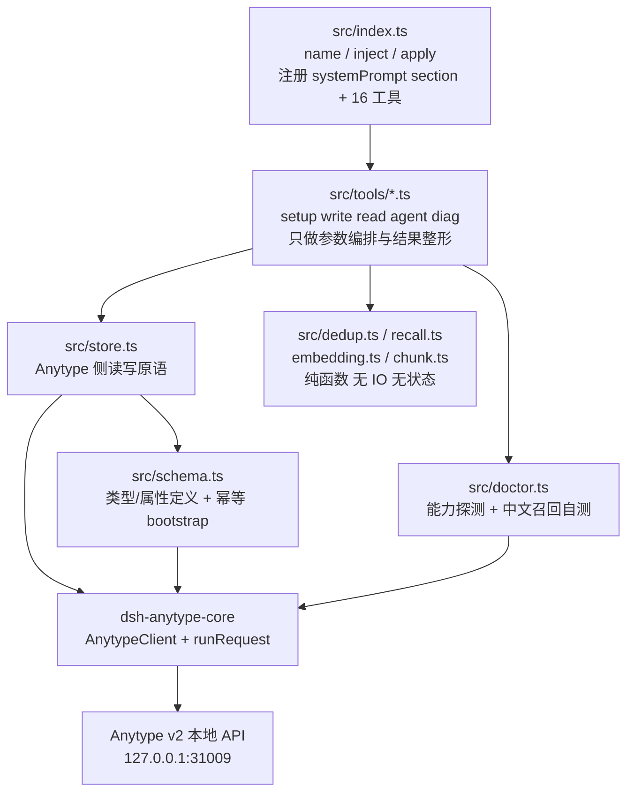
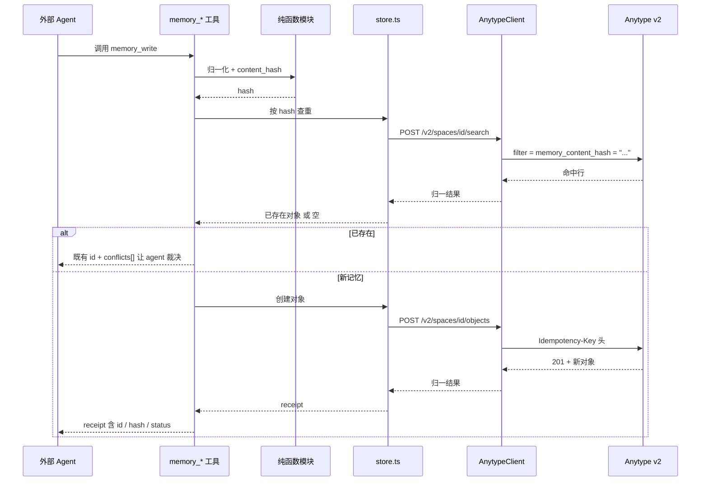

# dsh-anytype-memory 架构设计

> **本文回答什么问题**：这个插件长什么样、边界在哪、各个模块负责什么、为什么这样切分，以及哪些结论还只是纸面推断。
>
> **阅读前置**：
>
> - 了解 dsh 插件契约（`name` / `apply(ctx)` / `inject` / `ctx.effect`），参见仓库根 `AGENTS.md` 与 `.agents/skills/dsh-plugin-dev/SKILL.md`。
> - 了解 Anytype v2 本地 API 的基本形状（对象 = `properties` + `blocks`，搜索走 `POST /v2/spaces/{id}/search`），本文件只复述与插件决策相关的部分。
> - 同目录另有《工具 API 参考》文档，逐个工具的参数/返回契约以那份为准；本文件只描述**架构与取舍**，两者若有出入以工具 API 参考为准。
> - **路径约定**：本文出现的 `packages/dsh-anytype-memory/**` 与 `packages/dsh-anytype-core/**` 为**规划态**路径（尚未落盘）；`packages/dsh-anytype/**` 为仓库现状。

---

## 1. 一句话定位

`dsh-anytype-memory` 把「一个用户指定的 Anytype 空间」变成 agent 的长期记忆工作区：记忆本体、属性、关系、向量**全部以 Anytype 对象的形式存在**，插件自身**零本地状态**。

它不是「本地记忆库 + Anytype 导出」的混合体，也不是「Anytype 的语法糖封装」。它是一层**薄适配器**：把 Anytype 的对象/属性/关系语义翻译成 agent 可用的记忆读写工具，把一切需要语义判断的部分（要不要记、是不是重复、怎么合并、怎么总结、向量怎么算）**外包回给 agent**。

---

## 2. 七条硬约束

| #   | 约束                            | 含义                                                            | 落地方式                                                                                                                   | 校验点                                                                          |
| --- | ------------------------------- | --------------------------------------------------------------- | -------------------------------------------------------------------------------------------------------------------------- | ------------------------------------------------------------------------------- |
| C1  | **零本地状态**                  | 插件不落 SQLite、不写本地文件、不建本地索引、不缓存任何记忆正文 | 所有读写直穿 `AnytypeClient` → `http://127.0.0.1:31009`；纯函数模块（dedup/recall/embedding/chunk）不持有跨调用状态        | 审阅 `src/**` 无 `fs` / `node:sqlite` / `better-sqlite3` 依赖；无进程级可变缓存 |
| C2  | **不调用 LLM / embedding 模型** | 插件不做任何模型推理                                            | 插件只做归一化、哈希、集合运算、余弦相似度；抽取/去重裁决/摘要/嵌入/重排全部由 agent 用自己的模型完成                      | 依赖清单无模型 SDK；`src/embedding.ts` 只做 base64 编解码与余弦                 |
| C3  | **不发起非 localhost 网络请求** | 只与本机 Anytype 通信                                           | `baseUrl` 默认 `http://127.0.0.1:31009`，允许配置但需显式改写；无任何 fetch 第三方域                                       | 代码审阅 + `memory_doctor` 报告 `baseUrl` 取值                                  |
| C4  | **语义工作外包给 agent**        | 插件是「事实执行器」不是「决策者」                              | 写路径遇重复 → 返回既有 id + `conflicts[]` 让 agent 裁决；rollup → 只出计划不出手                                          | 写工具返回体里必须有 `conflicts` / `plan` 字段而不是直接改记忆                  |
| C5  | **API v2 是预发布**             | 能力面不得硬编码                                                | 启动/首用时探测 `GET /v2/docs/openapi.json` 与 `GET /v2/schemas/*`；schema 由 `src/schema.ts` 定义并**幂等引导**           | `memory_doctor` 输出能力矩阵与降级建议                                          |
| C6  | **限流：持续 1 req/s，突发 60** | 密集调用会 429                                                  | 写路径串行、读路径合并往返（一次 search 带 `fields` 投影多属性）、批量投影 embedding 分批                                  | 工具侧不重试风暴；失败把 429 原文交还 agent                                     |
| C7  | **只增不删**                    | 记忆不物理删除                                                  | 遗忘 = `salience` 衰减 + `status=archived`；矛盾 = 新对象 + `supersedes` 边 + 旧对象 `status=superseded` + `valid_to` 落定 | 全流程不出现 `DELETE /objects`（仅 `memory_doctor` 清理自身探针）               |

### 2.1 为什么「零本地状态」是架构主线而不是口号

零本地状态直接推导出四条设计后果：

1. **没有离线可用性**：Anytype 桌面端没开，所有工具立即失败。这是刻意的——记忆和宿主同生共死。
2. **没有跨会话性能优化**：没有本地倒排索引，全文检索靠 Anytype 自己的索引，因此**一次 search 要能一次问出多个答案**（靠 `fields` 投影，而不是多次往返）。
3. **没有本地 ID 映射**：一切引用都是 Anytype 对象 id，`memory` 之间的关系用 Anytype 原生 relation 表达（`links` / `backlinks` 双向自动）。
4. **没有本地事务**：写操作靠 `Idempotency-Key` 防重 + `If-Match` 乐观锁，而不是本地事务回滚。插件只能保证「重放同一请求不产生副作用」。

---

## 3. 包布局

### 3.1 目标布局

```
packages/dsh-anytype-core/        # 规划新增：共享底座（从 dsh-anytype 抽取）
  src/client.ts                    # AnytypeClient / AnytypeError / toToolValue / renderValue / buildUrl
  src/shared.ts                    # runRequest / outputSpec / enc / DRY_RUN_PARAM / IDEMPOTENCY_KEY_PARAM / ToolDeps
  src/index.ts                     # barrel

packages/dsh-anytype/             # 既有插件：30 个原生 dsh 工具封装 Anytype v2 REST
  # 抽取后改为依赖 core，行为不变

packages/dsh-anytype-memory/      # 规划新增：本次设计的落点
  src/index.ts                     # name='dsh-anytype-memory'；inject=['tools','systemPrompt']
  src/config.ts                    # volatile 配置（schemastery），全字段下次调用即生效
  src/schema.ts                    # Anytype 侧 schema 定义 + 幂等 bootstrap
  src/store.ts                     # Anytype 侧读写（create/update/link/supersede/archive/review）
  src/dedup.ts                     # content_hash 归一化 + 幂等 + 冲突候选（纯）
  src/recall.ts                    # RRF / boost / 预算 / 状态过滤（纯）
  src/embedding.ts                 # base64(Float32) codec + 余弦 + 维度/模型校验（纯）
  src/chunk.ts                     # 确定性零 LLM 分块（纯）
  src/doctor.ts                    # 能力探测 + 中文召回自测
  src/tools/{setup,write,read,agent,diag}.ts
  docs/
```

### 3.2 为什么抽出 `dsh-anytype-core`

`packages/dsh-anytype/src/client.ts` 与 `packages/dsh-anytype/src/tools/shared.ts` 已经把 v2 API 的**全部 HTTP 语义**收敛干净（认证头、`Anytype-Version`、`If-Match`、`Idempotency-Key`、超时/取消、错误归一、截断）。两个插件若各写一份，v2 预发布期的协议漂移会立刻变成两份债务。

抽取原则：

| 规则                         | 说明                                                                                                                                                                                                    |
| ---------------------------- | ------------------------------------------------------------------------------------------------------------------------------------------------------------------------------------------------------- |
| 只抽**与业务无关**的传输层   | HTTP 客户端、错误类型、输出规格、URL 拼装、参数常量                                                                                                                                                     |
| 不抽**任何记忆语义**         | `content_hash` 归一化、RRF、embedding codec 留在 memory 包内                                                                                                                                            |
| `dsh-anytype` 行为**零变化** | 抽取后 `packages/dsh-anytype` 的 30 个工具的参数、返回值、错误文本与当前一致                                                                                                                            |
| barrel 导出面收窄            | `src/index.ts` 只导出 `AnytypeClient` / `AnytypeError` / `toToolValue` / `renderValue` / `buildUrl` / `runRequest` / `outputSpec` / `enc` / `DRY_RUN_PARAM` / `IDEMPOTENCY_KEY_PARAM` / `ToolDeps` 类型 |

`ToolDeps` 里 `config()` 的返回类型是 `ResolvedConfig`——两个插件的 resolved 配置形状不同，因此 core 里必须用**泛型或结构化最小接口**（只要 `maxResponseChars` 与 `client`），否则 core 反向依赖业务包。具体签名待实现时定稿，此处标 **[待活体验证]**：验证方式是抽取后跑 `pnpm typecheck` 与 `pnpm test`，并对比 `packages/dsh-anytype` 全部既有测试用例通过。

### 3.3 `dsh-anytype-memory` 内部模块分层



分层规则：**纯函数层不依赖 `AnytypeClient`**（便于用 `vi` 直接单测），**工具层不直接发 HTTP**（一律经 `store.ts`），**`schema.ts` 是唯一知道 Anytype 类型/属性名的模块**（记忆模型的字典只有这一处副本）。

---

## 4. 运行时架构

### 4.1 一次调用的完整链路



### 4.2 agent 与插件的分工边界

| 职责                       | 插件做                                                       | agent 做                               |
| -------------------------- | ------------------------------------------------------------ | -------------------------------------- |
| 决定「这条信息值不值得记」 | 提供白名单说明（systemPrompt section）                       | 判断并调用 `memory_write`              |
| 抽取结构化字段             | 提供字段字典与校验                                           | 填写 `kind` / `content` / `confidence` |
| 去重裁决                   | 算 `content_hash`（存为 `memory_content_hash` 属性）、给候选 | 决定 merge / supersede / create        |
| 嵌入向量                   | base64 编解码、余弦、维度校验                                | 用自己的 embedding 模型算向量并回写    |
| 总结 / 巩固                | 只出「相似簇 + 合并计划」                                    | 用自己的 LLM 写合并稿并回写            |
| 重排                       | RRF + 乘性 boost                                             | 决定最终引用哪些                       |
| 状态机                     | 执行 approved / disputed / archived / superseded 迁移        | 发起评审、给出裁决                     |

**插件永远不替 agent 改写记忆内容**，只执行被请求的原子变更。

---

## 5. 模块职责表

| 文件               | 职责                                                                                           | 允许的依赖                       | 禁止                            |
| ------------------ | ---------------------------------------------------------------------------------------------- | -------------------------------- | ------------------------------- |
| `src/index.ts`     | 插件入口；导出 `name` / `inject` / `apply`；注册 systemPrompt 指引 section；按组注册 16 个工具 | cordis、`dsh-system-prompt` 类型 | 直接发 HTTP                     |
| `src/config.ts`    | schemastery `Config` + `resolveConfig`；volatile 字段全量热生效                                | `@deepseek-ai/schemastery`       | 读 `process.env` 之外的隐藏配置 |
| `src/schema.ts`    | `memory` / `memory_scope` 类型与属性的**唯一定义源**；幂等 bootstrap（只补缺失）               | `store.ts`                       | 覆盖用户手工调整过的同名属性    |
| `src/store.ts`     | Anytype 侧读写原语：create / update / link / supersede / archive / review / search / get       | `dsh-anytype-core`               | 包含任何打分逻辑                |
| `src/dedup.ts`     | 归一化 → `content_hash`；幂等键推导；冲突候选构造                                              | 无（纯）                         | 任何 IO                         |
| `src/recall.ts`    | RRF（k=60）、乘性 boost、状态过滤、token 预算截断                                              | 无（纯）                         | 任何 IO                         |
| `src/embedding.ts` | `base64(Float32)` 编解码、余弦相似度、模型名与维度校验                                         | 无（纯）                         | 调用任何模型                    |
| `src/chunk.ts`     | 确定性分块（段落/句边界优先，长块再按长度切）                                                  | 无（纯）                         | 任何 IO、任何随机数             |
| `src/doctor.ts`    | 能力探测矩阵 + 中文召回自测 + 降级建议                                                         | `store.ts`                       | 修改用户数据（仅删自身探针）    |
| `src/tools/*.ts`   | 参数编排、互斥校验、结果整形                                                                   | 上述各模块                       | 复制协议细节                    |

### 5.1 为什么把纯函数单独拆文件

`dedup` / `recall` / `embedding` / `chunk` 是四个**最可能出 bug 且最容易测**的模块：哈希归一化差一点就会误判重复，RRF 参数写错就会静默丢召回，embedding 维度错配会让余弦恒等于 NaN。把它们从 HTTP 路径里剥出来，测试可以脱离 Anytype 活体运行，也避免「每次改召回都要连本地 API」。

---

## 6. 工具面（16 个）

工具按 **setup / write / read / agent / diag** 五组落地在 `src/tools/{setup,write,read,agent,diag}.ts`。逐工具的参数与返回契约见同目录《工具 API 参考》，此处只给架构视角的归类。

| 组    | 工具                   | 写?          | 并发安全 | 架构要点                                                                                 |
| ----- | ---------------------- | ------------ | -------- | ---------------------------------------------------------------------------------------- |
| setup | `memory_setup`         | 是（建类型） | 否       | 幂等 bootstrap；重复执行**零新建**；返回 created/skipped 清单                            |
| write | `memory_write`         | 是           | 否       | 归一化 → hash → 查重 → 近邻 → 写；带 `Idempotency-Key`                                   |
| write | `memory_update`        | 是           | 否       | 乐观锁（`If-Match`）；只改白名单属性，禁止改 `memory_content_hash`                       |
| write | `memory_link`          | 是           | 否       | 写 relation 边；受控边名白名单                                                           |
| write | `memory_supersede`     | 是           | 否       | 新建 + `supersedes` 边 + 旧条 `superseded` + `valid_to`；**永不覆盖旧条正文**            |
| write | `memory_archive`       | 是           | 否       | 遗忘 = 衰减 `memory_salience` + `memory_status=archived`，不删                           |
| write | `memory_review`        | 是           | 否       | 人工/agent 评审：approved / disputed / 退回 draft                                        |
| read  | `memory_recall`        | 否           | 是       | 三臂召回 + RRF + boost + 预算截断                                                        |
| read  | `memory_get`           | 否           | 是       | 按 id 取全量对象 + 属性 + 关系                                                           |
| read  | `memory_list`          | 否           | 是       | 按 memory_scope / memory_kind / memory_status 分页列举                                   |
| read  | `memory_search`        | 否           | 是       | 纯词法检索（透传 filter/sorts/fields）                                                   |
| read  | `memory_stats`         | 否           | 是       | 按 memory_kind / memory_status / memory_scope 聚合统计（走 search + 本地聚合，零持久化） |
| agent | `memory_candidates`    | 否           | 是       | 给 agent 的裁决素材：重复候选、冲突候选、待巩固簇                                        |
| agent | `memory_set_embedding` | 是           | 否       | agent 回写自己的向量；插件只做 base64 + 维度/模型校验                                    |
| agent | `memory_suggest_links` | 否           | 是       | 建议关系边（不写），供 agent 决定                                                        |
| diag  | `memory_doctor`        | 有限         | 否       | 能力探测 + 中文召回自测 + 探针清理 + 降级建议                                            |

### 6.1 工具面的三条设计律

1. **写工具全部带 `dry_run` 与 `idempotency_key`**（复用 core 的 `DRY_RUN_PARAM` / `IDEMPOTENCY_KEY_PARAM` 描述文案，语义与 `packages/dsh-anytype` 一致）：预演创建返 200、真创建返 201；同 key 同体重放已存响应、同 key 换 body 返 409 `idempotency_conflict`。
2. **读工具全部声明 `isConcurrencySafe: true`**：召回链路的三个臂互相独立，可并行。
3. **每个写工具返回 `receipt`**：至少含 `id` / `content_hash` / `status` / `created`（是否新建）/ `applied`（实际生效的属性），让 agent 不必回读就能确认结果。

---

## 7. 配置模型

配置全部走 **volatile**（schemastery `.volatile()`），保存即生效，无需重载插件；`enabled` 是例外——它决定「注册哪些工具」，属装载期决策，改动需重载插件（与 `packages/dsh-anytype` 的既有差异一致，在指引 section 中向用户说明）。

| 字段                  | 默认                     | 作用                                                      |
| --------------------- | ------------------------ | --------------------------------------------------------- |
| `enabled`             | `true`                   | 总开关；关闭时保留指引 section 但不注册工具               |
| `baseUrl`             | `http://127.0.0.1:31009` | Anytype 本地 API 地址                                     |
| `apiKey`              | `''`                     | Bearer 密钥（Anytype 应用设置 → API Keys → 创建）         |
| `apiVersion`          | `2025-11-08`             | `Anytype-Version` 头                                      |
| `spaceId`             | `''`                     | 记忆所在空间；为空时所有记忆类工具报可操作错误            |
| `memoryTypeKey`       | `memory`                 | 记忆对象类型 key（改它等于换记忆库）                      |
| `scopeTypeKey`        | `memory_scope`           | 作用域对象类型 key                                        |
| `defaultScopeKey`     | `''`                     | 默认软作用域（project/agent/user 之一）                   |
| `writeKinds`          | 全部                     | 允许写入的 `kind` 白名单（对应「写入白名单」）            |
| `minConfidence`       | `1`                      | 低于该 `confidence` 的候选不进召回结果                    |
| `rrfK`                | `60`                     | RRF 平滑常数                                              |
| `recencyHalfLifeDays` | `30`                     | recency 衰减半衰期                                        |
| `boostWeights`        | 三元组                   | `recency` / `confidence` / `proof` 的乘性权重             |
| `recallTokenBudget`   | `2000`                   | 召回结果的 token 预算上限                                 |
| `vectorTopM`          | `50`                     | 向量臂候选数 M                                            |
| `embeddingDim`        | `0`                      | 期望维度；0 = 不校验（由实际写入的 `embedding_dim` 决定） |
| `requestTimeoutMs`    | `30000`                  | 单请求超时                                                |
| `maxResponseChars`    | `20000`                  | 工具结果截断上限                                          |
| `disabledGroups`      | `[]`                     | 按组停用（setup/write/read/agent/diag）                   |

---

## 8. Anytype 侧的能力依赖面

插件依赖的 API 能力（全部需在 `memory_doctor` 中探测，v2 预发布期不得假设稳定）：

| 能力                          | 端点                                                                              | 依赖强度                                                      |
| ----------------------------- | --------------------------------------------------------------------------------- | ------------------------------------------------------------- |
| 对象增删改查                  | `GET                                                                              | POST /v2/spaces/{id}/objects`、`GET                           | PATCH      | DELETE /v2/spaces/{id}/objects/{oid}` | **强依赖** |
| 全文检索 + 过滤 + 排序 + 投影 | `POST /v2/spaces/{id}/search`                                                     | **强依赖**                                                    |
| 类型与属性定义                | `GET                                                                              | POST /v2/spaces/{id}/types`、`GET /v2/spaces/{id}/properties` | **强依赖** |
| 对象分页列举                  | `GET /v2/spaces/{id}/objects`                                                     | 中（list / stats 用）                                         |
| 关系与反向链接                | `links` / `backlinks` 属性投影 + `backlinks IS NOT EMPTY` 过滤                    | 中（关系臂）                                                  |
| 能力面自描述                  | `GET /v2/docs/openapi.json`、`GET /v2/schemas/{kind}`、`GET /v2/schemas/ops/{op}` | 中（doctor 用）                                               |
| 身份与授权范围                | `GET /v2/auth/whoami`                                                             | 弱（doctor 用）                                               |
| 乐观锁                        | 响应 `ETag` + `If-Match`                                                          | 中（update / supersede 用）                                   |
| 防重                          | `Idempotency-Key` 头                                                              | 中（写路径用）                                                |
| 预演                          | `?dry_run=true`                                                                   | 弱（可用性优化，非必需）                                      |

**已知缺口**：`GET /v2/spaces/{id}/properties/{key}` 单属性 GET 在当前构建上返回 404，因此属性清单只能靠 `GET /v2/spaces/{id}/properties` 全量列举再本地挑选。

---

## 9. 错误与降级策略

| 场景                                | 插件行为                                                                                                           |
| ----------------------------------- | ------------------------------------------------------------------------------------------------------------------ |
| Anytype 桌面端未启动 / 端口不通     | `AnytypeError`（status 0, code `NETWORK`），文案直接指向「Anytype 应用未运行？」；agent 收到的是可操作文本而非堆栈 |
| 401 / 403                           | 明确提示 key 无效或无该空间授权（**空间是硬边界**）                                                                |
| 404 单属性 GET                      | 不再依赖该端点；改用属性清单全量列举                                                                               |
| 409 `idempotency_conflict`          | 同 key 换 body 才发生——提示 agent 换新 key，不要原样重试                                                           |
| 409 `If-Match` 失败                 | 提示「对象已被他人改动，请先 `memory_get` 重读」                                                                   |
| 429 限流                            | 原样交还 agent，建议串行 + 退避；插件不做无限重试                                                                  |
| 400 `ambiguous_input`               | `filter` 与 `filters` 同传——工具层提前拦下，给出「二选一」提示                                                     |
| 能力缺失（如 `backlinks` 不可过滤） | `memory_doctor` 标记该项为不可用，召回降级为「词法臂 + 向量臂」，关系臂置空并在结果里说明                          |
| v2 结构漂移                         | 以 `GET /v2/docs/openapi.json` / `GET /v2/schemas/*` 为准，schema 引导失败时给出「人工创建 type/property」的清单   |

---

## 10. 风险登记册

| 风险                                                 | 影响                 | 缓解                                                                           |
| ---------------------------------------------------- | -------------------- | ------------------------------------------------------------------------------ |
| v2 预发布，字段/端点可能改名                         | 插件直接不可用       | 能力面运行时探测；`memory_doctor` 出一键降级建议；schema 引导幂等且可重跑      |
| 限流 1 req/s                                         | 高频召回变慢         | 少往返（一次 search 带 `fields` 投影多属性）、分批取 embedding、读工具并发安全 |
| `fields` 是投影而非裁剪                              | 响应体变大           | 用 `filter` 收窄集合 + `limit` 分页；`maxResponseChars` 兜底截断               |
| 跨 API key 删除被拒（403 `not_created_by_this_key`） | 插件自建的探针清不掉 | 探针与正式记忆用同一 key 创建；失败时在 doctor 报告里列出残留对象 id           |
| 空间被删除/迁移                                      | 记忆丢失             | 空间无删除端点，属外部操作；`memory_doctor` 校验当前 `spaceId` 仍可访问        |
| 插件零状态 → 无性能缓存                              | 召回延迟高           | 接受该代价；把预算放在**减少往返**而非本地缓存                                 |
| 语义判断外包给 agent                                 | 记忆质量依赖 agent   | systemPrompt 指引 section 明确写入白名单与裁决规则；`memory_review` 留人工闸门 |

---

## 11. 验证计划

以下结论标 **[待活体验证]**，验证方式逐条列出：

| 待验证项                                                  | 验证方式                                                                                                             |
| --------------------------------------------------------- | -------------------------------------------------------------------------------------------------------------------- |
| `dsh-anytype-core` 抽取后 `dsh-anytype` 行为不变          | 抽取前后各跑一次 `pnpm typecheck && pnpm test`，既有 `packages/dsh-anytype/src/*.test.ts` 全绿                       |
| `fields` 投影原生 `links` / `backlinks` 返回对象 id 数组  | 在目标空间建两个互链对象，`POST /v2/spaces/{id}/search` 带 `fields=["links","backlinks"]`，断言返回数组元素为对象 id |
| `memory_content_hash` 参与 filter 等值过滤可行            | 建一条带 `content_hash` 的 memory，`filter='memory_content_hash = "..."'` 断言命中 1                                 |
| `backlinks IS NOT EMPTY` 等值过滤在目标构建可用           | 已被 2026-10-23 活体验证（17 命中）；换构建版本后需复验                                                              |
| `Idempotency-Key` 在 objects 创建上生效                   | 同 key 同 body 连发两次，断言第二次重放同一 id（201 → 200 或响应体相同）                                             |
| `dry_run` 创建返回 200 vs 真实 201                        | 已在 2026-10-21 活体验证；换构建版本需复验                                                                           |
| 中文召回可用（分词/索引不丢中文）                         | `memory_doctor` 写中文探针对象 → 用中文关键词 search → 断言命中 → 删除探针                                           |
| `POST /v2/spaces/{id}/types` 可幂等补属性而不覆盖用户改动 | 手工改一个 memory 属性名后重跑 `memory_setup`，断言该属性未被覆盖                                                    |

---

## 12. 不做的事

- 不做本地记忆缓存、离线队列、本地全文索引。
- 不做后台定时任务（cordis `ctx.effect` 只用于注册与清理，不用于轮询 Anytype）。
- 不在插件内做任何模型调用或向量计算服务。
- 不做跨空间记忆同步（空间即硬边界，越权无意义）。
- 不提供「清空记忆」接口（`memory_archive` 是逐条归档；整空间清空属 Anytype 侧的人工操作）。
