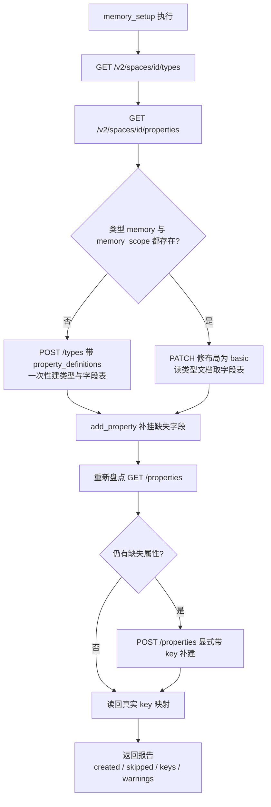
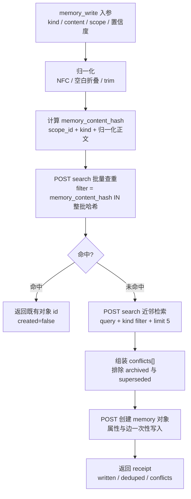
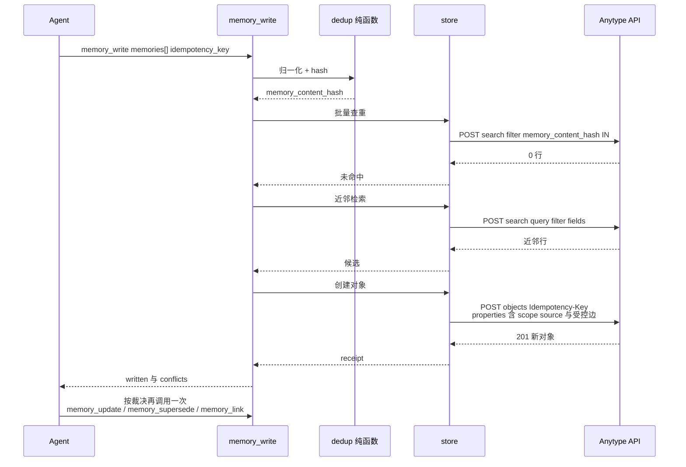
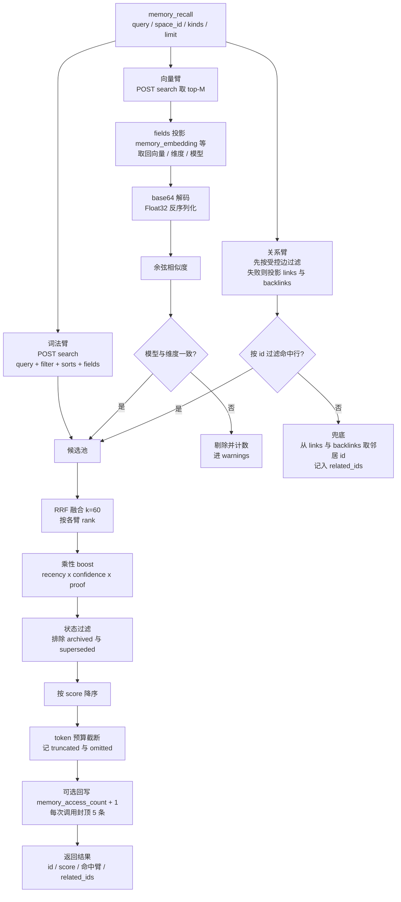
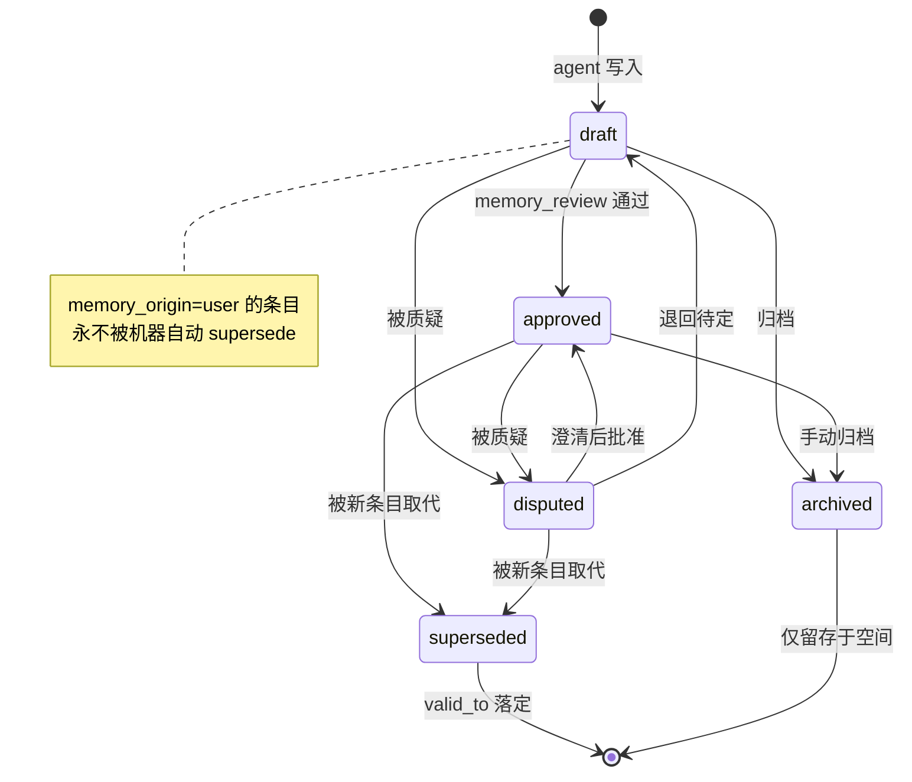
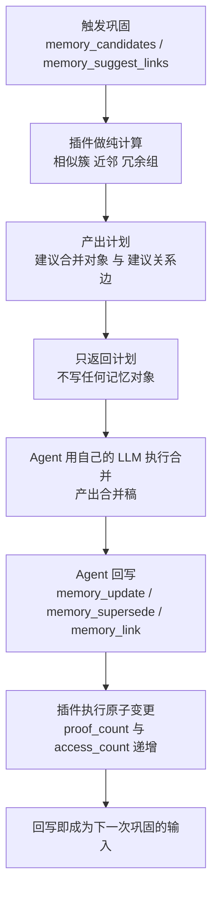
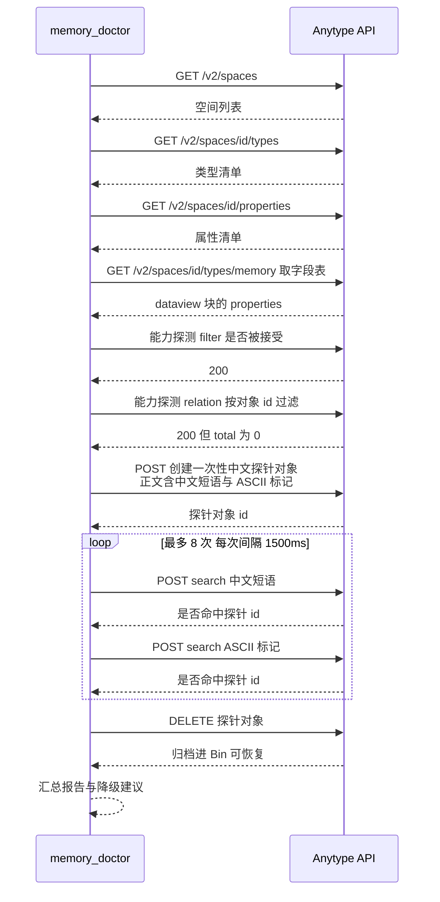
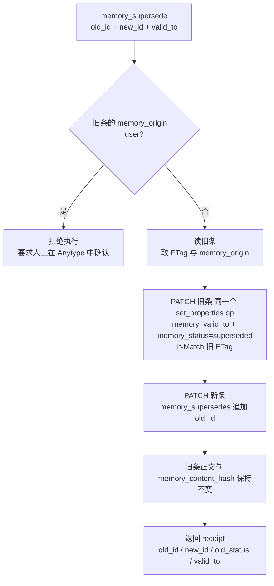

# dsh-anytype-memory 关键流程

> **本文回答什么问题**：一次写入怎么走、一次召回怎么走、状态怎么流转、初始化怎么保证幂等、自检怎么跑、巩固怎么不越权。
>
> **阅读前置**：
>
> - 已读《01 架构设计》与《02 记忆模型》。
> - 工具的参数/返回契约见同目录《工具 API 参考》；本文件只描述**流程编排与数据流**。
> - **路径约定**：`packages/dsh-anytype-memory/**` 为规划态路径。

---

## 流程索引

| #   | 流程                  | 入口工具                                                | 图                   |
| --- | --------------------- | ------------------------------------------------------- | -------------------- |
| ①   | 幂等初始化            | `memory_setup`                                          | flowchart            |
| ②   | 写入路径              | `memory_write` / `memory_update` / `memory_link`        | flowchart + sequence |
| ③   | 召回路径              | `memory_recall`                                         | flowchart            |
| ④   | 状态流转              | `memory_review` / `memory_supersede` / `memory_archive` | stateDiagram         |
| ⑤   | 巩固 / rollup         | `memory_candidates` / `memory_suggest_links`            | flowchart            |
| ⑥   | 自检                  | `memory_doctor`                                         | sequenceDiagram      |
| ⑦   | 取代（supersede）细则 | `memory_supersede`                                      | flowchart            |

---

## ① 幂等初始化（bootstrap）

**目的**：在目标空间里把 `memory` 与 `memory_scope` 两个类型及其属性**补齐**，且**重复执行零新建**。

### 流程图

### 三段式时序（活体实测 2026-10-23 后的定稿）

| 段                  | 做什么                                                                                                              | 为什么不能省                                                                                                    |
| ------------------- | ------------------------------------------------------------------------------------------------------------------- | --------------------------------------------------------------------------------------------------------------- |
| ① 建类型            | 缺类型时 `POST /v2/spaces/{id}/types`，带 `property_definitions`（显示名 + `format` + `options`）                   | 一次往返铸完整字段表，避开本地 API **持续 1 req/s** 的限速                                                      |
| ② 修布局 + 补字段表 | 已存在的类型先 `PATCH {layout}` 校正为 `basic`；再读类型文档的字段表（见下），把缺失属性用 `add_property` op 挂进去 | **属性不在字段表里 → 按类型过滤/查询时该键被拒绝**，`filter: memory_kind IN (...)` 会直接失效                   |
| ③ 重新盘点补建      | **建完类型必须重新读一次属性清单**，只对**仍然缺失**的属性 `POST /v2/spaces/{id}/properties`（显式带 `key`）        | 第 ① 段建类型时**顺带把字段铸成了空间属性**，继续按启动时的清单建会撞 `property key already exists`（活体实测） |

### 步骤表

| 步  | 动作                                                                                  | 幂等键                             | 失败处理                                                                                                                         |
| --- | ------------------------------------------------------------------------------------- | ---------------------------------- | -------------------------------------------------------------------------------------------------------------------------------- |
| 1   | 读 `GET /v2/spaces/{id}/types`                                                        | —                                  | 失败即整体中止（无法判定缺什么）                                                                                                 |
| 2   | 读 `GET /v2/spaces/{id}/properties`                                                   | —                                  | 同上；**注意**单属性 GET `GET /v2/spaces/{id}/properties/{key}` 在当前构建 404，只能全量列举                                     |
| 3   | 缺类型则 `POST /types`（`layout=basic` + `property_definitions`）                     | 类型 key `memory` / `memory_scope` | 同名属性已存在时**省略 `format`**（沿用既有定义）并告警；建类型带 `Idempotency-Key`                                              |
| 4   | 已存在的类型：`PATCH /types/{key}` 校正 `layout=basic`                                | —                                  | 失败**不中断**，写进 `warnings[]`                                                                                                |
| 5   | 读类型文档取**字段表**：`GET /types/{key}` → `blocks[0]`（dataview）的 `properties[]` | —                                  | 字段表读不到 → 字段补挂退化为「只保证空间里存在该属性」                                                                          |
| 6   | 缺失属性用 `PATCH /types/{key}` 的 `add_property` op 挂进字段表                       | 属性 key                           | op **只认 `property`（key）+ `format`**，传 `name` 报 `json: unknown field "name"`；空间里已有同名属性时**省略 `format`** 并告警 |
| 7   | **重新盘点** `GET /properties`，对仍缺的属性 `POST /properties`（显式带 `key`）       | 属性 key                           | 不重新盘点会撞 `property key already exists`                                                                                     |
| 8   | 读回真实 key（按显示名匹配）                                                          | —                                  | 匹配不到退回期望 key；漂移写进 `warnings[]`                                                                                      |
| 9   | 返回报告                                                                              | —                                  | `space_id` / `space_created` / `created[]` / `skipped[]` / `keys{}` / `warnings[]` / `schema_version`                            |

### 字段表到底是哪张表

> **活体实测（2026-10-23）**：**类型的字段表 = 类型文档 `blocks[0]`（dataview）的
> `properties[]`**。`GET /v2/spaces/{id}/types/{key}` 返回的类型文档里，第一个块是
> dataview，它的 properties 列表就是字段表。**属性不在字段表里 → 会被存储并随对象
> 返回，但按类型过滤/查询时该键被拒绝**（服务端原话："the value is stored and
> served on the object, but type-scoped search and queries over X refuse the key"）。
> 所以 bootstrap 必须把插件属性 `add_property` 进类型，否则
> `filter: memory_kind IN (...)` 这类收窄直接失效。

> **紧凑类型列表读不到字段表**：`GET /v2/spaces/{id}/types` 只给类型自身属性
> （name / creator / …），**字段表必须逐个读类型文档**。

### 幂等性的三个保证

| 保证         | 机制                                                                  |
| ------------ | --------------------------------------------------------------------- |
| 不重复建类型 | 先 `GET /v2/spaces/{id}/types` 判定存在性，key 已存在则跳过           |
| 不重复建属性 | 只补 `property_definitions` 里缺失的键，不整体覆盖已有定义            |
| 不重复撞 key | 补建属性前**重新盘点**属性清单（第 ③ 段），跳过建类型时顺带铸出的属性 |

> **不变量 I12**：第二次执行 `memory_setup` 的期望结果是 `created` 为空、`skipped` 覆盖全部条目。验证方式：连续跑两次，比对两次报告的 `created` 数组——第二次必须为空。

---

## ② 写入路径

**目的**：把 agent 给的一条候选记忆安全地变成（或复用到）一个 Anytype `memory` 对象；遇到潜在重复时**不擅自决定**，而是把裁决素材交回 agent。

### 流程图

### 关键步骤表

| 步  | 动作                     | Anytype 交互                                                                                    | 备注                                                                               |
| --- | ------------------------ | ----------------------------------------------------------------------------------------------- | ---------------------------------------------------------------------------------- |
| 1   | 归一化                   | 无                                                                                              | `src/dedup.ts` 纯函数，规则见《02 记忆模型》§6                                     |
| 2   | 算 `memory_content_hash` | 无                                                                                              | SHA-256 hex；哈希输入 = 归一化正文 + `kind`                                        |
| 3   | 精确查重（整批一次）     | `POST /v2/spaces/{id}/search`，`filter='memory_content_hash IN (...) AND memory_kind IN (...)'` | 命中即返回既有 id，**不新建**；`created=false`                                     |
| 4   | 近邻检索（逐条）         | `POST /v2/spaces/{id}/search`，`query` = 正文前 80 字符 + `filter`（同 kind）+ `fields` 投影    | 投影 `name` / `memory_kind` / `memory_status` / `memory_scope`                     |
| 5   | 组装冲突候选             | 本地组装                                                                                        | 只保留 **非** `archived` / `superseded` 的候选；其余给 `conflicts[]` 交 agent 裁决 |
| 6   | 交 agent 裁决            | 无                                                                                              | 插件**不**自行 merge/supersede；`memory_write` 返回 `conflicts[]`                  |
| 7   | 创建                     | `POST /v2/spaces/{id}/objects`，body = `{type:"memory", name, markdown?, properties}`           | **属性与边在同一次请求里写入**；带 `Idempotency-Key`；`dry_run` 可预演             |
| 8   | 返回                     | 无                                                                                              | 含 `written[]` / `deduped[]` / `conflicts[]` / `warnings[]`                        |

### 写入时序（含重试语义）

### 失败与降级

| 失败                                | 行为                                                                                       |
| ----------------------------------- | ------------------------------------------------------------------------------------------ |
| 查重 search 失败                    | 整个写入中止，错误交还 agent（**不做「查不到就当没重复」的乐观写入**）                     |
| 创建返回 409 `idempotency_conflict` | 说明同 key 换了 body——换新 key 重试；原文提示 agent                                        |
| 未知属性键 → 400                    | 服务端列出已知键并给「did you mean」；拼错的键**不会**被静默铸造                           |
| 未知 select 选项名 → 400            | 受控词表（kind/status/origin/source_channel）**不开** `create_missing_options`，拼错即报错 |
| `memory_scope` 指向的对象不存在     | 先建 scope 对象再挂（`memory_setup` 已建默认 scope 时不会发生）                            |

---

## ③ 召回路径

**目的**：用**三臂**（词法 / 向量 / 关系）拿到候选，融合成一条有序列表，在 token 预算内交给 agent。

### 流程图

### 三臂细节

| 臂   | 请求                                                                                                                                                                                  | 投影字段                                                                                                                                                                                                                                                                                                 | 备注                                                                                    |
| ---- | ------------------------------------------------------------------------------------------------------------------------------------------------------------------------------------- | -------------------------------------------------------------------------------------------------------------------------------------------------------------------------------------------------------------------------------------------------------------------------------------------------------- | --------------------------------------------------------------------------------------- |
| 词法 | `POST /v2/spaces/{id}/search`，`query` = 用户查询；`filter` = `memory_kind IN (...)` ∧（可选）`memory_status IN (...)`；`sorts` = `[{property:"memory_created_at",direction:"desc"}]` | `name` / `memory_kind` / `memory_status` / `memory_origin` / `memory_confidence` / `memory_importance` / `memory_proof_count` / `memory_salience` / `memory_access_count` / `memory_created_at` / `memory_valid_from` / `memory_scope` / `memory_source` / `memory_content_hash` / `links` / `backlinks` | 属性 key 由 `propertyKey()` 运行时解析为**服务端真实 key**；`fields` 是加内容不是减内容 |
| 向量 | 再一次 `search`（同 filter / sorts），`fields` 追加 `memory_embedding` / `memory_embedding_model` / `memory_embedding_dim`                                                            | 同左 + 向量三项                                                                                                                                                                                                                                                                                          | 解码长度 ≠ `memory_embedding_dim` → 剔除；`memory_embedding_model` 不符 → 剔除          |
| 关系 | 首选 `filter='memory_relates_to IN ("<id>",...) OR memory_derived_from IN (...) OR ...'`（种子取词法臂前 5 条）；**命中 0 行则兜底** 从已投影的 `links` / `backlinks` 取邻居 id       | `links` / `backlinks`                                                                                                                                                                                                                                                                                    | **活体实测**：服务端**接受**该 filter 但**匹配不到行**（`total=0`），故兜底不是可选项   |

### 融合与加权

| 阶段       | 公式 / 规则                                                                       |
| ---------- | --------------------------------------------------------------------------------- |
| RRF        | `score_rrf(d) = Σ_arms 1 / (60 + rank_arm(d))`；某臂未命中则该臂不贡献            |
| boost      | `score_final = score_rrf × recency^0.2 × confidence^0.2 × proof^0.1`（乘性）      |
| recency    | `clamp(1 - age_days / 365, 0.1, 1)`，基于 `memory_created_at`                     |
| confidence | `0.1 + (clamp(confidence,1,10) / 10) × 0.9`，缺失取 0.5                           |
| proof      | `min(1, 0.5 + proof_count × 0.1667)`，缺失取 0.5                                  |
| 状态过滤   | 默认排除 `archived` / `superseded`；`draft` 保留；`disputed` 保留并标记「有争议」 |
| 预算       | 累计 token 估算超预算即停，返回 `truncated=true` + `omitted_count`                |

### 返回体要点

| 字段                          | 含义                                                                                                                                                                       |
| ----------------------------- | -------------------------------------------------------------------------------------------------------------------------------------------------------------------------- |
| `items[]`                     | 每条含 `object_id` / `name` / `excerpt` / `score` / `arms_hit[]`（命中了哪些臂）/ `kind` / `status` / `origin` / `confidence` / `scope_id` / `content_hash` / `updated_at` |
| `arms_used[]`                 | 本次实际参与的臂（lexical / vector / links）                                                                                                                               |
| `related_ids[]`               | **关系臂兜底**给出的邻居对象 id（最多 20 个）——按 id 过滤失效时从原生 `links` / `backlinks` 取回                                                                           |
| `candidate_count`             | 参与融合的候选总数                                                                                                                                                         |
| `access_count_bumped`         | 本次实际回写 `memory_access_count` 的条数（默认 0；`bump_access_count=true` 时最多 5）                                                                                     |
| `warnings[]`                  | 降级与解释（如向量臂因模型/维度不符剔除的条数、关系臂按 id 过滤失效改走 `links`/`backlinks` 投影）                                                                         |
| `truncated` / `omitted_count` | 预算截断情况                                                                                                                                                               |

> **不变量 I13/I14**：默认结果不含 `archived` / `superseded`；返回体必须带
> `warnings[]` / `truncated` / `omitted_count` 这类可解释字段；**返回体不含
> 向量原文**（向量只在插件内部参与计算）。
>
> **口径已统一**（2026-10-23）：本节与 [05](./05-anytype-as-source.md) §5、
> 与实现 `src/recall.ts` 三方一致。

---

## ④ 状态流转

### 状态图

### 迁移表

| 起始                              | 目标         | 触发                                        | 前置条件                    | 副作用                                                                                                      |
| --------------------------------- | ------------ | ------------------------------------------- | --------------------------- | ----------------------------------------------------------------------------------------------------------- |
| —                                 | `draft`      | `memory_write`                              | agent 写入                  | `memory_origin=agent`，`memory_salience=1`，`memory_access_count=0`；`memory_status` 取配置 `defaultStatus` |
| `draft`                           | `approved`   | `memory_review(decision=approve)`           | 评审通过                    | 同时写 `memory_reviewed_by` / `memory_reviewed_at`                                                          |
| `draft` / `approved`              | `disputed`   | `memory_review(decision=dispute)`           | 存在冲突条目                | 写审计字段；矛盾边由 `memory_link` 建                                                                       |
| `disputed`                        | `approved`   | `memory_review(decision=approve)`           | 澄清完成                    | 同上                                                                                                        |
| `draft` / `approved` / `disputed` | `archived`   | `memory_archive` 或 `memory_review(reject)` | —                           | **不删除**；正文与 `memory_content_hash` 不变                                                               |
| `approved` / `disputed`           | `superseded` | `memory_supersede`                          | 旧条 `memory_origin ≠ user` | **同一个 op** 写 `memory_valid_to` + `memory_status`；正文与 `memory_content_hash` **不变**                 |

### 规则表

| 规则 | 说明                                                                                                                                               |
| ---- | -------------------------------------------------------------------------------------------------------------------------------------------------- |
| R1   | AI 写入一律 `draft`（可由配置 `defaultStatus` 改）；只有人工评审才能升 `approved`                                                                  |
| R2   | `memory_origin=user` 的条目**永不**进入自动 supersede 路径；`memory_supersede` 对此类旧条**拒绝执行**并要求人工确认                                |
| R3   | `superseded` 是终态（`memory_valid_to` 落定后不可回退）                                                                                            |
| R4   | `archived` 是终态但**可恢复**（人工在 Anytype 里改回 `approved` 即可）                                                                             |
| R5   | 状态迁移一律经 `memory_review` / `memory_archive` / `memory_supersede` 三个工具，不开放任意状态直写                                                |
| R6   | 每次状态迁移都写一条变更说明进对象正文尾部？——**否**：正文不可变，变更说明改由 `memory_derived_from` / `memory_supersedes` 边表达（**不变量 I3**） |

> R6 的澄清：早期设想「在正文尾部追加变更日志」被否决——它会改写 `content_hash`，破坏查重与「旧条正文不可变」两条不变量。

---

## ⑤ 巩固 / rollup（插件只出计划）

**目的**：识别冗余与可合并的记忆，但**不替 agent 改记忆**。

### 流程图

### 相似簇的判定依据（插件侧纯计算）

| 依据     | 计算                                       | 说明               |
| -------- | ------------------------------------------ | ------------------ |
| 标签重合 | `tag` 的 Jaccard 相似度                    | 最便宜，先用       |
| 词形重合 | 归一化正文的 token 交集率                  | 中等成本           |
| 向量近邻 | 余弦相似度（若条目有 `memory_embedding`）  | 最准，需先取回向量 |
| 派生链   | `memory_derived_from` / `memory_source` 边 | 同源记忆天然成簇   |

### 计划体结构

| 字段         | 含义                                                                                                                                         |
| ------------ | -------------------------------------------------------------------------------------------------------------------------------------------- |
| `clusters[]` | 每个簇：`members[]`（对象 id + 标题摘要）、`similarity`（0–1）、`suggested_action`（`merge_into:<id>` / `supersede:<id>` / `keep_separate`） |
| `links[]`    | 建议新增的边：`from` / `to` / `relation` / `reason`                                                                                          |
| `stats`      | 本次扫描的条目数、被聚类的条目数、跳过原因（无 embedding、无标签等）                                                                         |

> **不变量**：巩固流程**不产生任何写操作**。`memory_candidates` 与 `memory_suggest_links` 都是只读工具（`isConcurrencySafe: true`）。

---

## ⑥ 自检（`memory_doctor`）

**目的**：确认「这个空间 + 这套 API + 这套 schema」能不能支撑记忆插件正常工作，并给出降级建议。

### 时序图

### 检查项表

| #   | 检查                    | 方法                                                              | 通过                                       | 失败时的降级                                                                      |
| --- | ----------------------- | ----------------------------------------------------------------- | ------------------------------------------ | --------------------------------------------------------------------------------- |
| 1   | 空间可达                | `GET /v2/spaces` + 目标空间可列举                                 | 目标 `spaceId` 出现在列表                  | 报告 spaceId 不存在或未被授权（**空间是硬边界**）                                 |
| 2   | 类型与属性齐备          | `GET /types` + `GET /properties` + `GET /types/{key}`（取字段表） | `memory` / `memory_scope` 存在且字段表齐备 | 提示先跑 `memory_setup`；列出缺失属性清单                                         |
| 3   | filter 是否被服务端接受 | `filter='memory_kind IN ("fact")'`                                | 请求 200                                   | 关系臂与收窄失效 → 只能拉回后本地过滤                                             |
| 4   | relation 按对象 id 过滤 | `filter='memory_relates_to IN ("<真实对象 id>")'`                 | **实测：200 但 `total=0`**                 | 关系臂**兜底**为投影原生 `links` / `backlinks`，把邻居 id 作为 `related_ids` 返回 |
| 5   | 写探针                  | `POST /v2/spaces/{id}/objects`（一次性中文正文 + ASCII 标记）     | 201                                        | 报告写权限不足；**不删除**（未创建则无残留）                                      |
| 6   | 中文召回                | `POST /v2/spaces/{id}/search`，query 取探针中文短语，**轮询重试** | `verdict = chinese_recall_ok`              | 三态判定见下（索引滞后 / 分词不可靠）                                             |
| 7   | 清理探针                | `DELETE /v2/spaces/{id}/objects/{oid}`                            | 成功（归档进 Bin，可恢复）                 | 403 `not_created_by_this_key` → 报告残留对象 id，提示用同一 key 的客户端清理      |

### 中文自检：双探针 + 轮询 + 三态判定

> **活体实测（2026-10-23 / 2026-10-24）**：
>
> - ✅ **中文全文检索可用**——中文短语（如「持久记忆」「索引全部交给」「拒绝」）能命中
>   对象，**标题与正文都参与索引**。此前担心的「中文分词失效」被证伪：SQLite FTS5 的
>   `unicode61` 对中文失效是事实，但 **Anytype 桌面端自己的检索不走那条路**。
> - ⚠️ **但对生僻词/未登录词不可靠**：用生僻词（观澜 / 蓑笠 / 孤舟 …）做探针时，
>   探针对象**已进索引**（同对象的 ASCII 标记可命中）但**中文短语搜不到**。故探针
>   必须用**常用词**，才能反映「普通中文记忆能否被召回」这一真实场景。
> - ⚠️ **全文索引是最终一致的**：刚创建的对象**搜不到**，实测约 **3～6s** 后才可被
>   检索命中，且偶发更久。

**双探针设计**：同一个探针对象里放两段唯一的检索词——一段**中文短语**
（`记忆探针` + 随机两个常用字），一段 **ASCII 标记**（`zhprobe-<随机>`）。只靠中文
探针无法区分两种失败：

| 中文短语命中 | ASCII 标记命中 | `verdict`                    | 含义                                         | 处置                                             |
| ------------ | -------------- | ---------------------------- | -------------------------------------------- | ------------------------------------------------ |
| ✅           | —              | `chinese_recall_ok`          | 中文召回可用                                 | 正常使用                                         |
| ❌           | ✅             | `chinese_tokenization_issue` | 对象**已进索引**，是**中文分词对该词不可靠** | 改用标签 / 结构化过滤 / 向量臂，别依赖中文关键词 |
| ❌           | ❌             | `index_lag_or_unindexed`     | **索引滞后**（对象还没进全文索引）           | 隔几秒重跑 `memory_doctor` 确认                  |

**轮询参数**：当前实现**最多 8 次**、每次间隔 **1500ms**，每轮做**两次** search
（中文短语 + ASCII 标记），返回 `attempts` 与 `latency_ms`。

### 报告结构

| 字段                                         | 含义                                                                                    |
| -------------------------------------------- | --------------------------------------------------------------------------------------- |
| `api`                                        | `{reachable, authenticated, base_url}`                                                  |
| `visible_spaces[]`                           | 当前 key 可见的空间列表                                                                 |
| `schema.types[]`                             | 空间内类型摘要（key / name / 属性数）                                                   |
| `schema.property_count`                      | 空间属性总数                                                                            |
| `schema.memory_type_present`                 | `memory` 类型是否在位                                                                   |
| `schema.memory_type_properties[]`            | `memory` 类型的**字段表**（读类型文档的 dataview 块得到）                               |
| `capabilities.filter_works`                  | filter 是否被服务端接受并执行                                                           |
| `capabilities.relation_filter_works`         | relation filter 是否被服务端接受（**注意：接受 ≠ 能匹配到行**）                         |
| `capabilities.relation_filter_rows`          | relation filter 命中的行数（实测为 **0** → 关系臂走 `links`/`backlinks` 兜底）          |
| `capabilities.content_hash_property_present` | `memory_content_hash` 属性是否已就位                                                    |
| `chinese_recall.checked`                     | 是否做了中文自检                                                                        |
| `chinese_recall.matched`                     | 中文短语是否命中探针                                                                    |
| `chinese_recall.marker_matched`              | ASCII 标记是否命中探针（= 对象是否已进全文索引）                                        |
| `chinese_recall.verdict`                     | 三态判定：`chinese_recall_ok` / `chinese_tokenization_issue` / `index_lag_or_unindexed` |
| `chinese_recall.attempts`                    | **轮询尝试次数**（最多 8）                                                              |
| `chinese_recall.latency_ms`                  | **命中耗时**（毫秒）                                                                    |
| `chinese_recall.probe_archived`              | 探针是否已清理                                                                          |
| `warnings[]`                                 | 降级与解释                                                                              |

### 边界

`memory_doctor` 是**唯一**会调用 `DELETE` 的工具，且只删它自己刚建的探针对象
（探针由本 key 创建 → 删除合法）；其余任何流程都不删除记忆对象（**不变量 I2**）。

---

## ⑦ 取代（supersede）细则

> **前提**：`memory_supersede` **不创建新对象**——新条由调用方先用
> `memory_write` 建好（`status=draft`），本工具只负责「让旧条失效」并
> 在新条上建 `memory_supersedes` 边。

### 流程图

### 步骤表

| 步  | 动作                                                                                                          | 失败处理                                                             |
| --- | ------------------------------------------------------------------------------------------------------------- | -------------------------------------------------------------------- |
| 1   | 读旧条（`GET /v2/spaces/{id}/objects/{oid}`），取 `memory_origin` 与 `ETag`                                   | 旧条不存在 → 报错中止                                                |
| 2   | 检查 `memory_origin`                                                                                          | `user` → **拒绝**，返回「该条目由用户确立，请人工在 Anytype 中处理」 |
| 3   | **一次 PATCH** 写 `memory_valid_to` + `memory_status=superseded`（同一个 `set_properties` op），带 `If-Match` | 409 → 说明旧条已被改动，**不覆盖**，回报最新状态让 agent 重新决策    |
| 4   | PATCH 新条：`memory_supersedes` 追加 `old_id`                                                                 | 失败 → 旧条已转 superseded 但边未写，可用 `memory_link` 补           |
| 5   | 返回 receipt                                                                                                  | —                                                                    |

> **为什么必须一次写完（活体实测 2026-10-23）**：**同一个 etag 只能写一次**——
> 连续两次 `PATCH`（即便都带同一个 `If-Match` etag）第二次必得
> **409 `etag_mismatch`**。故 `memory_valid_to` 与 `memory_status=superseded`
> **合并进同一个 `set_properties` op**（一次原子写），绝不拆成两次 PATCH。

> **跨对象原子性**：Anytype 无跨对象事务，第 3、4 步之间存在窗口。窗口内的状态是
> 「旧条已转 superseded 但新条边未写」——此时新条暂时没有追溯边，旧条已退出召回
> （保守方向：宁可少召回一条，不可让失效事实继续被当真）。这是刻意选择。

---

## 跨流程的一致性检查表

| 检查                                                | 涉及流程               |
| --------------------------------------------------- | ---------------------- |
| 同一 `Idempotency-Key` 重放不产生重复对象           | ② 写、⑦ 取代           |
| 写前必查重，命中即返回既有 id                       | ② 写                   |
| 状态迁移只在三个工具里发生                          | ④ 状态、⑦ 取代         |
| 旧条正文与 `memory_content_hash` 不变               | ④ 状态、⑦ 取代         |
| `memory_origin=user` 不被机器取代                   | ④ 状态、⑦ 取代         |
| 召回排除 `archived` / `superseded`                  | ③ 召回                 |
| 召回命中可选回写 `memory_access_count`（封顶 5 条） | ③ 召回                 |
| 巩固流程零写操作                                    | ⑤ 巩固                 |
| 只有 doctor 会 DELETE，且只删自己的探针             | ⑥ 自检                 |
| 初始化重复执行零新建                                | ① 初始化               |
| 属性必须挂在类型字段表里（否则按类型过滤被拒）      | ① 初始化、② 写、③ 召回 |
