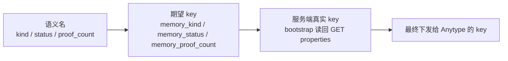

# 04 · 工具 API 契约

> **本文回答什么问题**
>
> 1. `dsh-anytype-memory` 向 agent 暴露了哪 16 个工具，每个工具的参数、返回 JSON、错误语义分别是什么；
> 2. 写操作如何做到「可预演（`dry_run`）、可重试（`idempotency_key`）、不覆盖、不丢信息」；
> 3. 哪些错误是「换个用法就能成」的**可操作错误**，哪些必须交还给 agent 决策（`conflicts[]`）。
>
> **阅读前置**
>
> - `05-anytype-as-source.md`：Anytype v2 的能力边界、三臂召回与 RRF 融合设计；
> - `06-llm-vector-delegation.md`：插件的硬边界（不跑 LLM / 不跑 embedding / 零本地状态）与 agent 侧 SOP；
> - `packages/dsh-anytype/README.md`：本仓已沉淀的 Anytype v2 活体实测结论（`filter` 紧凑语法、`fields` 是**投影**而非裁剪、`Idempotency-Key` / `dry_run` 语义、409 是共享错误码）；
> - `02-memory-model.md` §2：属性字典与**三层 key 映射**（语义名 → 期望 key → 服务端真实 key）；
> - 本文出现的工具名、属性名、端点路径与实现 `src/` 保持逐字一致。

---

## 1. 设计总则

| 约定       | 内容                                                                                                                                                            |
| ---------- | --------------------------------------------------------------------------------------------------------------------------------------------------------------- |
| 命名空间   | 全部工具以 `memory_` 前缀；与 `packages/dsh-anytype` 的 `anytype_*` 工具不重名、不重叠职责（`anytype_*` 是通用 Anytype 读写，本包是**记忆语义层**）             |
| 返回形态   | **成功时直接返回下表定义的 JSON 对象**（无额外外壳）；**失败时抛错**，`Error.message` 必须是可操作文本                                                          |
| 错误信息   | Anytype 的 `status` / `code` / `message` / `issues[]`（`path` / `message` / `hint`）原样保留在错误文本里，不做二次美化                                          |
| 并发标注   | 只读工具声明 `isConcurrencySafe: () => true`，可与同批读调用并行调度；写工具**不声明**（串行执行）                                                              |
| 写工具安全 | 8 个写工具**全部**带 `dry_run`（预演）；`memory_write` / `memory_link` 另带 `idempotency_key`（防重）                                                           |
| 空间范围   | 所有工具只访问 `http://127.0.0.1:31009`（Anytype 桌面端本地 API）；空间级参数统一叫 `space_id`（**字符串**，不是对象）                                          |
| 原始向量   | **任何工具的返回值都不包含 `memory_embedding` 原值**（召回结果里只有 `score`，`memory_get` 的属性映射里保留 `memory_embedding_model` / `memory_embedding_dim`） |
| 全库上下文 | 任何工具都**不提供**「导出整库」模式；召回永远受 `limit` + `max_tokens` 约束                                                                                    |

### 1.1 `space_id` 参数形状

**所有**空间级工具（除 `memory_setup` 另有 `space_name`）都接受同一个可选参数：

```json
{
  "space_id": "64xiwe"
}
```

- `space_id`：**可选**，Anytype 空间短引用 id（活体实测形如 `64xiwe`）；
- 省略时插件按配置的 `spaceId`（钉住）→ `spaceName`（按名解析，进程内缓存）工作；
- **作用域（scope）不是参数**：记忆条目的 `memory_scope` 属性由 `memory_write` 的
  `scope_id` 逐条指定，插件不提供「本次调用限定某个 scope」的过滤开关。

### 1.2 属性名的三层映射（工具层怎么说话）

工具层用**语义名**（`kind` / `status` / `content_hash` / `proof_count` …），
由 `src/tools/shared.ts` 的 `propertyKey()` 映射成最终下发给 Anytype 的 key：



| 层             | 规则                                                                                                                     |
| -------------- | ------------------------------------------------------------------------------------------------------------------------ |
| 语义名         | snake_case 与 camelCase 都认（`proof_count` ≡ `proofCount`）                                                             |
| 期望 key       | `src/schema.ts` 的 `MEMORY_PROPERTY_KEY` / `EDGE_PROPERTY_KEY` 集中表；一律 `memory_*` 前缀（`tag` 除外）                |
| 服务端真实 key | bootstrap 读回属性清单后按**显示名**匹配；匹配不到退回期望 key；漂移时 bootstrap 在 `warnings[]` 报 `property key drift` |

> **本文各工具表格里的「属性」列一律写语义名**——真实 key 由运行时解析。

### 1.3 时间与标识约定

| 概念           | 约定                                                                                                       |
| -------------- | ---------------------------------------------------------------------------------------------------------- |
| 时间戳         | 一律 ISO 8601 UTC，例：`2026-10-23T12:34:56Z`                                                              |
| `created_at`   | 记忆对象上的 `memory_created_at` 日期属性（写入时打点）                                                    |
| `updated_at`   | 召回结果里取的是 `memory_created_at`（Anytype 侧未单独暴露 modified 时间）                                 |
| `object_id`    | Anytype 对象 id（短引用形式，如 `3f9a...`）                                                                |
| `content_hash` | `sha256(scope_id \| kind \| normalize(content))` 的十六进制串；规范见 [05](./05-anytype-as-source.md) §6.1 |

### 1.4 工具总览

| #   | 工具                   | 组    | 读/写                          | 并发安全 | 主要端点                                                                                                                                                                                               |
| --- | ---------------------- | ----- | ------------------------------ | -------- | ------------------------------------------------------------------------------------------------------------------------------------------------------------------------------------------------------ |
| 1   | `memory_setup`         | setup | 写                             | 否       | `GET /v2/spaces`、`POST /v2/spaces`、`GET                                                                                                                                                              | POST /v2/spaces/{id}/types`、`PATCH /v2/spaces/{id}/types/{key}`、`GET | POST /v2/spaces/{id}/properties` |
| 2   | `memory_write`         | write | 写                             | 否       | `POST /v2/spaces/{id}/search`（去重 / 冲突探测）、`POST /v2/spaces/{id}/objects`                                                                                                                       |
| 3   | `memory_update`        | write | 写                             | 否       | `GET` + `PATCH /v2/spaces/{id}/objects/{oid}`                                                                                                                                                          |
| 4   | `memory_link`          | write | 写                             | 否       | `GET`（校验目标类型）+ `PATCH /v2/spaces/{id}/objects/{oid}`                                                                                                                                           |
| 5   | `memory_supersede`     | write | 写                             | 否       | `GET` + `PATCH`（旧条）+ `PATCH`（新条）                                                                                                                                                               |
| 6   | `memory_archive`       | write | 写                             | 否       | `PATCH /v2/spaces/{id}/objects/{oid}`                                                                                                                                                                  |
| 7   | `memory_review`        | write | 写                             | 否       | `PATCH /v2/spaces/{id}/objects/{oid}` ×2（状态 + 审计字段）                                                                                                                                            |
| 8   | `memory_recall`        | read  | 读                             | 是       | `POST /v2/spaces/{id}/search`（≤3 次）                                                                                                                                                                 |
| 9   | `memory_get`           | read  | 读                             | 是       | `GET /v2/spaces/{id}/objects/{oid}`（文档）+ `GET ...?format=md`（正文）                                                                                                                               |
| 10  | `memory_list`          | read  | 读                             | 是       | `POST /v2/spaces/{id}/search`（filter 收窄 + 分页）                                                                                                                                                    |
| 11  | `memory_search`        | read  | 读                             | 是       | `POST /v2/spaces/{id}/search`                                                                                                                                                                          |
| 12  | `memory_stats`         | read  | 读                             | 是       | `POST /v2/spaces/{id}/search`（投影后本地聚合）                                                                                                                                                        |
| 13  | `memory_candidates`    | agent | 读                             | 是       | `GET /v2/spaces/{id}/objects/{oid}`（读源对象）+ `POST /v2/spaces/{id}/search`                                                                                                                         |
| 14  | `memory_set_embedding` | agent | 写                             | 否       | `GET` + `PATCH /v2/spaces/{id}/objects/{oid}`                                                                                                                                                          |
| 15  | `memory_suggest_links` | agent | 读                             | 是       | `GET` + `POST /v2/spaces/{id}/search`                                                                                                                                                                  |
| 16  | `memory_doctor`        | diag  | 读（会建并删掉一个自己的探针） | 是       | `GET /v2/spaces`、`GET /v2/spaces/{id}/types`、`GET /v2/spaces/{id}/properties`、`GET /v2/spaces/{id}/types/{key}`、`POST /v2/spaces/{id}/search`、`POST`+`DELETE /v2/spaces/{id}/objects`（中文探针） |

---

## 2. `memory_setup` —— 幂等 bootstrap

**用途**：定位（或创建）记忆空间，建立 `memory` / `memory_scope` 两个对象类型及其属性集，并把属性挂进类型的**字段表**。**可重复调用**：已存在的资源一律跳过并记入 `skipped[]`。

| 参数           | 类型    | 必填 | 默认                                        | 含义                                                                  |
| -------------- | ------- | ---- | ------------------------------------------- | --------------------------------------------------------------------- |
| `space_name`   | string  | 否   | 配置的 `spaceName`（默认 `"Agent Memory"`） | 目标空间名。仅在未给 `space_id` 时用于「查找同名空间 → 找不到则创建」 |
| `space_id`     | string  | 否   | 配置的 `spaceId`                            | 已知空间 id；给出后**不再查找、不再创建**，直接在该空间内 bootstrap   |
| `create_space` | boolean | 否   | `true`                                      | 找不到目标空间时是否创建。为 `false` 时空间不存在即报错               |
| `dry_run`      | boolean | 否   | `false`                                     | 预演：只回报将要创建/跳过的资源，不落库                               |

**返回**

```json
{
  "space_id": "64xiwe",
  "space_created": false,
  "created": ["memory", "memory_kind", "memory_status"],
  "skipped": ["memory_scope"],
  "schema_version": "v1",
  "keys": {
    "memory_kind": "memory_kind",
    "memory_status": "memory_status",
    "tag": "tag"
  },
  "warnings": []
}
```

- `created[]`：本次**新建**的类型 key 与属性 key（两类混在一个数组里）；
- `skipped[]`：**已存在**的类型 key；
- `keys{}`：**期望 key → 服务端真实 key** 的映射（见 §1.2），后续读写都用它；
- `schema_version`：当前记忆 schema 版本（`v1`）；
- `warnings[]`：非致命偏差——同名属性格式不符（沿用既有定义）、属性 key 漂移、布局校正失败等。

**bootstrap 的三段式时序**（活体实测 2026-10-23 后的定稿）

| 段                  | 做什么                                                                                                          | 为什么                                                                                              |
| ------------------- | --------------------------------------------------------------------------------------------------------------- | --------------------------------------------------------------------------------------------------- |
| ① 建类型            | 缺类型时 `POST /v2/spaces/{id}/types`，带 `property_definitions`（显示名 + `format` + `options`）               | 一次往返铸完整字段表，避开本地 API **持续 1 req/s** 的限速                                          |
| ② 修布局 + 补字段表 | 已存在的类型先 `PATCH {layout}` 校正为 `basic`；再读**类型文档的字段表**，把缺失属性用 `add_property` op 挂进去 | **属性不在字段表里 → 按类型过滤/查询时该键被拒绝**，`filter: memory_kind IN (...)` 会直接失效       |
| ③ 重新盘点补建      | **建完类型必须重新读一次属性清单**，只对**仍然缺失**的属性 `POST /v2/spaces/{id}/properties`（显式带 `key`）    | 第 ① 段建类型时**顺带把字段铸成了空间属性**，继续按启动时的清单建会撞 `property key already exists` |

**字段表到底是哪张表**

> **活体实测（2026-10-23）**：**类型的字段表 = 类型文档 `blocks[0]`（dataview）的
> `properties[]`**。`GET /v2/spaces/{id}/types/{key}` 返回的类型文档里，第一个块是
> dataview，它的 properties 列表就是字段表。**属性不在字段表里 → 会被存储并随对象
> 返回，但按类型过滤/查询时该键被拒绝**（服务端原话："the value is stored and
> served on the object, but type-scoped search and queries over X refuse the key"）。
>
> **紧凑类型列表读不到字段表**：`GET /v2/spaces/{id}/types` 只给类型自身属性
> （name / creator / …），字段表必须**逐个读类型文档**。

**命名纪律**

> 空间自带一批内置属性（实测 **41 个**：`origin(number)`、`source(url)`、
> `status(select)`、`tag(multi_select)`、`links` / `backlinks(objects)`、
> `assignee`、`creator`、`due_date`、`done` …）。插件若用 `Origin` / `Source` /
> `Status` 这类朴素显示名铸属性，会与既有属性**同名不同格式** → 服务端
> **400 `property format conflict`**（issues 指到 `/type_properties/N/format`，
> 提示「omit format to use the existing property as it is, or create a new
> property under a different key」）。故插件属性一律 `Memory ` 前缀（key 派生为
> `memory_*`），**唯一例外是 `tag`**——直接复用内置 `tag(multi_select)`。

**错误语义**

| 情形                              | 行为                                                      | agent 该怎么办                          |
| --------------------------------- | --------------------------------------------------------- | --------------------------------------- |
| Anytype 未运行 / 连接被拒         | 抛错：「Anytype 应用未运行？…」                           | 先启动桌面应用，再重试                  |
| 401                               | 抛错：API key 无效                                        | 到 Anytype 设置里重建 key               |
| 403                               | 抛错：grant 不足（`grant.permission` 非 `read_write`）    | 在 Anytype 里给该 key 授写权限          |
| `create_space=false` 且空间不存在 | 抛错，指明可用空间 id 列表                                | 换 `space_id` 重试                      |
| 属性同名但格式不符                | **不报错**，省略 `format` 沿用既有定义并记入 `warnings[]` | 读 `warnings[]` 后决定是否换空间        |
| `add_property` op 传了 `name`     | 服务端 400 `json: unknown field "name"`                   | op **只认 `property`（key）+ `format`** |

**调用示例**

```json
{
  "tool": "memory_setup",
  "arguments": {
    "space_name": "Agent Memory",
    "create_space": true,
    "dry_run": true
  }
}
```

---

## 3. `memory_write` —— 批量写入

**用途**：把一批候选记忆写入空间。写入前先做**去重**（`memory_content_hash` 命中）与**冲突探测**（同 kind 的近邻既有记忆），冲突**不由插件裁决**，而是原样放进 `conflicts[]` 交还 agent。

| 参数              | 类型          | 必填 | 默认    | 含义                                     |
| ----------------- | ------------- | ---- | ------- | ---------------------------------------- |
| `memories`        | array<object> | 是   | 无      | 待写入条目，**1..50** 条                 |
| `space_id`        | string        | 否   | 配置值  | 目标空间                                 |
| `idempotency_key` | string        | 否   | 无      | 幂等键；**重试同一请求必须复用同一 key** |
| `dry_run`         | boolean       | 否   | `false` | 预演，不落库                             |

`memories[]` 元素字段：

| 字段               | 类型     | 必填 | 默认                           | 含义                                                                                                                          |
| ------------------ | -------- | ---- | ------------------------------ | ----------------------------------------------------------------------------------------------------------------------------- |
| `kind`             | string   | 是   | 无                             | `fact` \| `decision` \| `preference` \| `lesson` \| `procedure` \| `episode` \| `summary` \| `entity`（非法值抛错并列出枚举） |
| `content`          | string   | 是   | 无                             | 记忆正文（参与 `memory_content_hash` 计算）；为空串报错                                                                       |
| `name`             | string   | 否   | 由 `content` 截断（≤200 字符） | 对象标题——**记忆的「一行事实」就是它**（`basic` 布局下才保得住标题）                                                          |
| `body`             | string   | 否   | 无                             | 正文 markdown（落为对象的块）；缺省时对象只有标题                                                                             |
| `tags`             | string[] | 否   | 无                             | 写入内置 `tag`（multi_select）属性                                                                                            |
| `scope_id`         | string   | 否   | 无                             | 归属的 `memory_scope` 对象 id（写 `memory_scope` 属性）                                                                       |
| `source_object_id` | string   | 否   | 无                             | 来源素材对象 id（写 `memory_source` 属性）                                                                                    |
| `source_channel`   | string   | 否   | 无                             | `user` \| `tool` \| `web` \| `agent`（写 `memory_source_channel` 属性）                                                       |
| `confidence`       | number   | 否   | 无                             | 置信度 **1–10 整数**                                                                                                          |
| `importance`       | number   | 否   | 无                             | 重要度 **1–10 整数**                                                                                                          |
| `supersedes`       | string[] | 否   | 无                             | 本条取代的既有对象 id（写 `memory_supersedes` 边；**不**自动改旧条状态）                                                      |

> **`status` / `origin` 由插件决定，不接受逐条指定**：`memory_status` 取配置
> `defaultStatus`（默认 `draft`），`memory_origin` 恒为 `agent`。
> 「这条是用户亲口说的」目前**无法**通过本工具表达——见《02 记忆模型》§4.1。

**返回**

```json
{
  "written": [
    {
      "object_id": "3f9a...",
      "created": true,
      "content_hash": "9c1d0f...",
      "kind": "preference",
      "status": "draft"
    }
  ],
  "deduped": [
    {
      "object_id": "7b21...",
      "content_hash": "9c1d0f...",
      "kind": "preference",
      "reason": "identical content already stored in this scope"
    }
  ],
  "conflicts": [
    {
      "object_id": "aa03...",
      "kind": "preference",
      "status": "approved",
      "excerpt": "用户偏好使用 pnpm 而非 npm 管理依赖",
      "against": "3f9a...",
      "action": "decide: merge / supersede / keep both"
    }
  ],
  "warnings": []
}
```

- `written[]`：本次新建的条目；
- `deduped[]`：因 `memory_content_hash` 相同而**未写入**，既有对象 id 直接回传，agent 可改用 `memory_update`；
- `conflicts[]`：既有记忆与本次内容**语义相近但不相同**（同 kind 的近邻检索结果，已排除 `archived` / `superseded`），**插件不合并、不删除、不改写**——由 agent 决定 `merge` / `supersede` / `create`；
- `warnings[]`：如「本批全部命中去重，什么都没写」。

**错误语义**

| 情形                               | 行为                                                                         |
| ---------------------------------- | ---------------------------------------------------------------------------- |
| `memories` 为空                    | 抛错（可操作：至少给一条 `{kind, content}`）                                 |
| `kind` 非法值                      | 抛错，列出 8 个合法枚举值                                                    |
| `content` 为空串                   | 抛错，指出第几条目                                                           |
| 未知属性键 → 400                   | 服务端列出已知键并给「did you mean」；拼错的键**不会**被静默铸造             |
| 未知 select 选项名 → 400           | 受控词表**不开** `create_missing_options`，拼错即报错；开放词表 `tag` **开** |
| `idempotency_key` 复用但 body 不同 | 透传 409 `idempotency_conflict`——**换新 key**（body 已变）                   |
| 限速 429                           | 透传；提示「用**同一** `idempotency_key` 稍后重试」                          |

**调用示例**

```json
{
  "tool": "memory_write",
  "arguments": {
    "idempotency_key": "w-2026-10-23-001",
    "memories": [
      {
        "kind": "preference",
        "content": "用户偏好使用 pnpm 而非 npm 管理依赖",
        "name": "用户偏好 pnpm",
        "tags": ["tooling", "pnpm"],
        "source_channel": "user",
        "confidence": 9,
        "importance": 7
      },
      {
        "kind": "decision",
        "content": "记忆层选用 Anytype 作真源，放弃本地 SQLite 索引，因为实测 API 已覆盖全文检索与过滤排序",
        "source_channel": "agent",
        "confidence": 8
      }
    ]
  }
}
```

---

## 4. `memory_update` —— 局部更新

**用途**：对一个既有记忆做**局部**修改。Anytype v2 **没有整档替换接口**，因此正文修改只能走 `replace_text`（字符串替换）或 `insert_blocks`（插入块）。

| 参数              | 类型          | 必填 | 默认    | 含义                                                                   |
| ----------------- | ------------- | ---- | ------- | ---------------------------------------------------------------------- |
| `object_id`       | string        | 是   | 无      | 目标记忆对象 id                                                        |
| `ops`             | array<object> | 是   | 无      | 至少 1 条编辑指令                                                      |
| `expected_etag`   | string        | 否   | 无      | 乐观锁：作为 `If-Match` 头下发；不匹配 → 409                           |
| `if_content_hash` | string        | 否   | 无      | 乐观锁第二形态：先读对象比对 `memory_content_hash`，不符即冲突（不写） |
| `space_id`        | string        | 否   | 配置值  | 目标空间                                                               |
| `dry_run`         | boolean       | 否   | `false` | 预演                                                                   |

`ops[]` 支持的 `op`：

| `op`             | 字段                                                                                         | 含义                                                                                                                                             |
| ---------------- | -------------------------------------------------------------------------------------------- | ------------------------------------------------------------------------------------------------------------------------------------------------ |
| `replace_text`   | `old_text`（string，必填）、`new_text`（string，必填）                                       | 在正文中替换一段文字；`old_text` 必须在正文中唯一出现，否则报可操作错误                                                                          |
| `insert_blocks`  | `markdown`（string）或 `blocks`（array<object>）、`position`（`end` \| `start`，默认 `end`） | 插入内容块；`markdown` 里的换行必须是**真实换行符**（写成 `\n` 字面量会被并进同一段落）                                                          |
| `set_properties` | `set`（object）、`unset`（string[]）、`add`（object）、`remove`（object）                    | 属性操作；成员名是 `set`/`unset`/`add`/`remove`（**不是** `properties`）；`set` 的值语义见《02 记忆模型》§2.4；`add` / `remove` 仅对列表型键有效 |

**返回**

```json
{
  "object_id": "3f9a...",
  "updated": true,
  "ops": 1
}
```

**错误语义**

| 情形                                   | 行为                                                                                        |
| -------------------------------------- | ------------------------------------------------------------------------------------------- |
| 409（`If-Match` 过期）                 | 透传服务端错误（含当前 etag）；**不覆盖**他人改动                                           |
| `old_text` 不存在或不唯一              | 抛错，指出匹配次数与候选片段                                                                |
| 未知属性键 → 400                       | 服务端列出已知键并给「did you mean」                                                        |
| `ops` 为空                             | 抛错，列出三种 op 的形状                                                                    |
| `set_properties` 写 `memory_embedding` | 插件不阻止，但向量协议由 `memory_set_embedding` 负责（见 `06-llm-vector-delegation.md` §3） |

> **同一个 etag 只能写一次**（活体实测 2026-10-23）：连续两次 `PATCH`（即便都带
> 同一个 `If-Match` etag）第二次必得 **409 `etag_mismatch`**。故**多字段变更必须
> 合并进同一个 `set_properties` op**——这是 `memory_supersede` 把
> `memory_valid_to` 与 `memory_status` 合并成一次原子写的直接原因。

**调用示例**

```json
{
  "tool": "memory_update",
  "arguments": {
    "object_id": "3f9a...",
    "ops": [
      {
        "op": "set_properties",
        "set": { "memory_status": "approved", "memory_confidence": 9 },
        "add": { "tag": ["reviewed"] }
      }
    ]
  }
}
```

---

## 5. `memory_link` —— 建立受控关系

**用途**：在两个记忆对象之间建立一条**受控边**。受控边共 5 种：`relates_to`、`derived_from`、`contradicts`、`supersedes`、`mentions`。

| 参数              | 类型    | 必填 | 默认    | 含义                                                                                                                                                         |
| ----------------- | ------- | ---- | ------- | ------------------------------------------------------------------------------------------------------------------------------------------------------------ |
| `from_id`         | string  | 是   | 无      | 起点对象 id                                                                                                                                                  |
| `to_id`           | string  | 是   | 无      | 终点对象 id                                                                                                                                                  |
| `rel`             | string  | 是   | 无      | 5 种受控边之一：`relates_to` / `derived_from` / `contradicts` / `supersedes` / `mentions`。`source` 由 `memory_write` 的 `source_object_id` 写入，不走本工具 |
| `space_id`        | string  | 否   | 配置值  | 目标空间                                                                                                                                                     |
| `expected_etag`   | string  | 否   | 无      | 乐观锁：作为 `If-Match` 头下发                                                                                                                               |
| `idempotency_key` | string  | 否   | 无      | 幂等键                                                                                                                                                       |
| `dry_run`         | boolean | 否   | `false` | 预演                                                                                                                                                         |

**返回**

```json
{ "ok": true, "rel": "derived_from", "from_id": "aa03...", "to_id": "3f9a..." }
```

**实现说明**：边是 **objects 类属性**（`memory_relates_to` 等），写入时用
`set_properties` 的 `add` 成员（对列表型键追加对象 id）。因为 API v2 的
`create_type` / `create_property` **没有「relation 指向哪个类型」的字段**，
「边只连记忆对象」这条不变量由**插件层校验**：`memory_link` 写入前先读目标对象，
其 `type` 不是 `memory` 即抛错。

**错误语义**

| 情形                           | 行为                             |
| ------------------------------ | -------------------------------- |
| `rel` 不在 5 种之内            | 抛错，列出合法枚举               |
| `from_id` / `to_id` 之一不存在 | 抛错，指明是哪一个、404          |
| 端点对象类型不是 `memory`      | 抛错（关系只在记忆对象之间建立） |

**调用示例**

```json
{
  "tool": "memory_link",
  "arguments": {
    "from_id": "aa03...",
    "to_id": "3f9a...",
    "rel": "contradicts"
  }
}
```

---

## 6. `memory_supersede` —— 取代关系

**用途**：让旧记忆失效——旧对象 `memory_status` 置 `superseded`、`memory_valid_to` 打点，并在新对象上建 `memory_supersedes` 边。**它不创建新对象**（新条由调用方先用 `memory_write` 建好）。

| 参数       | 类型    | 必填 | 默认          | 含义                       |
| ---------- | ------- | ---- | ------------- | -------------------------- |
| `old_id`   | string  | 是   | 无            | 被取代的旧对象 id          |
| `new_id`   | string  | 是   | 无            | 取代它的新对象 id          |
| `valid_to` | string  | 否   | 当前 UTC 时间 | 旧记忆失效时刻（ISO 8601） |
| `space_id` | string  | 否   | 配置值        | 目标空间                   |
| `dry_run`  | boolean | 否   | `false`       | 预演                       |

**返回**

```json
{
  "old_id": "aa03...",
  "new_id": "3f9a...",
  "old_status": "superseded",
  "valid_to": "2026-10-23T12:40:00.000Z"
}
```

**硬约束**：若旧对象的 `memory_origin` 为 `user`，插件**拒绝自动改写**并抛错——用户亲自写下的文本不能被 agent 悄悄替换。agent 的可选路径是：改用 `memory_update` 把旧对象置 `disputed`（保留原文、交由用户裁决），或先向用户确认再由用户口径写入新对象。

**一次原子写**：`memory_valid_to` 与 `memory_status=superseded` **合并进同一个
`set_properties` op**（活体实测：同一 etag 只能写一次，拆成两次 PATCH 第二次必 409）。

**错误语义**

| 情形                              | 行为                                                           |
| --------------------------------- | -------------------------------------------------------------- |
| 旧对象 `memory_origin=user`       | 抛错，提示改用 `memory_update` 置 `disputed`，或走用户确认流程 |
| 任一 id 不存在 / 非 `memory` 类型 | 抛错（404 / 类型不符）                                         |
| 旧对象 409（已被他人改动）        | 透传，不覆盖                                                   |

**调用示例**

```json
{
  "tool": "memory_supersede",
  "arguments": { "old_id": "aa03...", "new_id": "3f9a..." }
}
```

---

## 7. `memory_archive` —— 归档（永不删除）

**用途**：把记忆从活跃集合中移出。**记忆条目的删除路径不存在**——`DELETE /v2/spaces/{id}/objects/{oid}` 只对本 API key 创建的对象有效（否则 403 `not_created_by_this_key`），且 HTTP v2 **没有删除 space 的端点**，故一律走归档。

| 参数            | 类型    | 必填 | 默认    | 含义                                       |
| --------------- | ------- | ---- | ------- | ------------------------------------------ |
| `object_id`     | string  | 是   | 无      | 目标对象 id                                |
| `reason`        | string  | 否   | 无      | 归档理由（只回传给调用方，**不写回对象**） |
| `expected_etag` | string  | 否   | 无      | 乐观锁：作为 `If-Match` 头下发             |
| `space_id`      | string  | 否   | 配置值  | 目标空间                                   |
| `dry_run`       | boolean | 否   | `false` | 预演                                       |

**返回**

```json
{
  "object_id": "3f9a...",
  "status": "archived",
  "reason": "内容已被 2026-10 的新决策取代"
}
```

**副作用**：只改 `memory_status = archived`。**正文与 `memory_content_hash` 一律不改**（正文不可变，见《02 记忆模型》§4.3）。

`reason` **只回传给调用方，不写回对象**——插件不往正文里追加归档尾注（那会改写 `memory_content_hash`，破坏查重）。需要留存归档理由时，让 agent 另写一条 `kind=episode` 的记忆并用 `memory_link` 建 `mentions` 边。

**错误语义**

| 情形            | 行为                          |
| --------------- | ----------------------------- |
| 对象不存在      | 抛错（404）                   |
| 已是 `archived` | 幂等返回 `status: "archived"` |

---

## 8. `memory_review` —— 评审与状态流转

**用途**：对一批记忆做人工/agent 评审，推进 `memory_status` 状态机，并留下审计字段。

| 参数         | 类型     | 必填 | 默认     | 含义                                       |
| ------------ | -------- | ---- | -------- | ------------------------------------------ |
| `object_ids` | string[] | 是   | 无       | 待评审对象 id 列表（非空）                 |
| `decision`   | string   | 是   | 无       | `approve` \| `reject` \| `dispute`         |
| `note`       | string   | 否   | 无       | 评审备注（只回传给调用方，**不写回正文**） |
| `actor`      | string   | 否   | `"user"` | 裁决者标识（写 `memory_reviewed_by`）      |
| `space_id`   | string   | 否   | 配置值   | 目标空间                                   |
| `dry_run`    | boolean  | 否   | `false`  | 预演                                       |

**状态映射**：`approve` → `approved`；`dispute` → `disputed`；`reject` → `archived`（驳回即归档，**不是删除**）。退回 `draft`（补充证据）不属于评审决定，走 `memory_update` 的 `set_properties` 显式设 `memory_status=draft`。

**返回**

```json
{
  "updated": ["3f9a...", "aa03..."],
  "status": "approved",
  "reviewed_by": "user",
  "reviewed_at": "2026-10-23T12:40:00.000Z",
  "note": "证据充分，批准"
}
```

**副作用**：写 `memory_status` 与两个审计字段 `memory_reviewed_by` / `memory_reviewed_at`。**正文与 `memory_content_hash` 一律不改**——评审理由 `note` 只回传给调用方。

**错误语义**

| 情形              | 行为                  |
| ----------------- | --------------------- |
| `decision` 非法   | 抛错，列出 3 个合法值 |
| `object_ids` 为空 | 抛错                  |

---

## 9. `memory_recall` —— 三臂召回

**用途**：按 token 预算召回最相关的记忆。三条臂：**lexical**（Anytype 全文检索）、**vector**（agent 提供查询向量，插件本地算余弦）、**links**（关系邻域）。融合与打分算法见 `05-anytype-as-source.md` §5。

| 参数                | 类型     | 必填 | 默认                           | 含义                                                           |
| ------------------- | -------- | ---- | ------------------------------ | -------------------------------------------------------------- |
| `query`             | string   | 否   | 无                             | 自然语言查询（词法臂）                                         |
| `space_id`          | string   | 否   | 配置值                         | 目标空间                                                       |
| `kinds`             | string[] | 否   | 全部                           | 限定 kind 子集（写进 `memory_kind IN (...)`）                  |
| `status`            | string[] | 否   | 全部（再按状态可见性过滤）     | 限定 status 子集（写进 `memory_status IN (...)`）              |
| `arms`              | string[] | 否   | 全部三臂                       | `lexical` \| `vector` \| `links`                               |
| `query_vector`      | number[] | 否   | 无                             | 查询向量；长度必须与库中 `memory_embedding_dim` 一致           |
| `embedding_model`   | string   | 否   | 无                             | 与 `query_vector` 配套的模型名；与库中对象不匹配的对象会被排除 |
| `limit`             | integer  | 否   | 配置 `recallLimit`（20）       | 每臂参与融合的候选条数上限                                     |
| `max_tokens`        | integer  | 否   | 配置 `recallMaxTokens`（4096） | **token 预算**（一等公民），超出即截断                         |
| `include_source`    | boolean  | 否   | `false`                        | 是否回传来源对象 id（`source_id`）                             |
| `bump_access_count` | boolean  | 否   | `false`                        | `true` = 回写 `memory_access_count`（每次调用**封顶 5 条**）   |

**返回**

```json
{
  "items": [
    {
      "object_id": "3f9a...",
      "name": "用户偏好 pnpm",
      "excerpt": "用户偏好使用 pnpm 而非 npm 管理依赖……",
      "score": 0.82,
      "arms_hit": ["lexical", "vector"],
      "kind": "preference",
      "status": "draft",
      "origin": "agent",
      "confidence": 9,
      "scope_id": "c1d2...",
      "content_hash": "9c1d0f...",
      "updated_at": "2026-10-23T12:34:56.000Z"
    }
  ],
  "truncated": true,
  "omitted_count": 4,
  "arms_used": ["lexical", "vector", "links"],
  "candidate_count": 17,
  "related_ids": ["aa03...", "bb14..."],
  "access_count_bumped": 0,
  "warnings": []
}
```

| 字段                          | 含义                                                                                                                                                                       |
| ----------------------------- | -------------------------------------------------------------------------------------------------------------------------------------------------------------------------- |
| `items[]`                     | 每条含 `object_id` / `name` / `excerpt` / `score` / `arms_hit[]`（命中了哪些臂）/ `kind` / `status` / `origin` / `confidence` / `scope_id` / `content_hash` / `updated_at` |
| `arms_used[]`                 | 本次**实际参与**的臂（`lexical` / `vector` / `links`）                                                                                                                     |
| `related_ids[]`               | **关系臂兜底**给出的邻居对象 id（最多 20 个）——按 id 过滤失效时从原生 `links` / `backlinks` 取回                                                                           |
| `candidate_count`             | 参与融合的候选总数                                                                                                                                                         |
| `access_count_bumped`         | 本次实际回写 `memory_access_count` 的条数                                                                                                                                  |
| `truncated` + `omitted_count` | 被预算裁掉的条数——**agent 必须知道「有东西没召回」**                                                                                                                       |
| `warnings[]`                  | 降级与解释（向量臂剔除数、关系臂按 id 过滤失效、预算守卫等）                                                                                                               |

- `excerpt`：**不含 `memory_embedding`**；
- **返回体不含向量原文**（向量只在插件内部参与计算）；
- 关系臂的兜底机制见《02 记忆模型》§9.1（活体实测：服务端**接受** relation 过滤但**匹配不到行**）。

**错误语义**

| 情形                                     | 行为                                                                      |
| ---------------------------------------- | ------------------------------------------------------------------------- |
| `arms` 含 `vector` 但未给 `query_vector` | **不抛错**：丢弃 vector 臂，其余臂照常返回，`warnings[]` 说明原因         |
| `query_vector` 长度与库中维度不符        | 该对象被排除，`warnings[]` 报告剔除条数；**绝不混用不同向量空间**         |
| `embedding_model` 与库中对象不符         | 同上排除                                                                  |
| 全库为空                                 | 返回 `{ items: [], truncated: false, omitted_count: 0, ... }`，不视为错误 |

**调用示例**

```json
{
  "tool": "memory_recall",
  "arguments": {
    "space_id": "64xiwe",
    "query": "依赖管理工具偏好",
    "arms": ["lexical", "vector"],
    "query_vector": [0.031, -0.118, 0.044, 0.207, 0.512],
    "embedding_model": "bge-m3",
    "limit": 5,
    "max_tokens": 1500
  }
}
```

> 上例的 `query_vector` 只列前 5 个分量；真实调用是**与库中 `memory_embedding_dim` 一致**的数字数组。

---

## 10. `memory_get` —— 单条记忆全貌

**用途**：取回一条记忆的完整内容：属性 + markdown 正文 + 出入关系。

| 参数             | 类型    | 必填 | 默认    | 含义                |
| ---------------- | ------- | ---- | ------- | ------------------- |
| `object_id`      | string  | 是   | 无      | 目标对象 id         |
| `space_id`       | string  | 否   | 配置值  | 目标空间            |
| `include_source` | boolean | 否   | `false` | 是否回传来源对象 id |

**返回**

```json
{
  "object_id": "3f9a...",
  "name": "用户偏好 pnpm",
  "type": "memory",
  "properties": {
    "name": "用户偏好 pnpm",
    "memory_kind": "preference",
    "memory_status": "draft",
    "memory_origin": "agent",
    "memory_scope": ["c1d2..."],
    "tag": ["tooling", "pnpm"],
    "memory_confidence": 9,
    "memory_importance": 7,
    "memory_salience": 1,
    "memory_proof_count": 0,
    "memory_access_count": 5,
    "memory_created_at": "2026-10-20T00:00:00.000Z",
    "memory_observed_at": "2026-10-20T00:00:00.000Z",
    "memory_content_hash": "9c1d0f..."
  },
  "body": { "blocks": [] },
  "markdown": "用户偏好使用 pnpm 而非 npm 管理依赖。\n",
  "links": ["ee77..."],
  "backlinks": ["aa03..."],
  "etag": "09691893"
}
```

- **标题在 `properties.name`**——对象文档（`GET /v2/spaces/{id}/objects/{oid}`）**没有顶层 `name` 字段**（活体实测 2026-10-23）；插件的 `name` 字段取 `properties.name`，取不到才回落到文档顶层；
- `properties` 里**没有 `memory_embedding` 原值**（只有 `memory_embedding_model` / `memory_embedding_dim`）；
- `links` / `backlinks` 是 Anytype **原生双向**关系的投影（对象 id 数组）；
- `etag` 是 Anytype 对象当前的乐观锁令牌，供 `memory_update` 的 `expected_etag` 使用。

**错误语义**

| 情形                                     | 行为                           |
| ---------------------------------------- | ------------------------------ |
| 对象不存在 / 不属于该空间                | 抛错（404），并提示该对象 id   |
| `include_source=true` 但对象没有来源属性 | 返回 `source_id: null`，不报错 |

---

## 11. `memory_list` —— 列举

**用途**：按 kind / status / tags 列举记忆（不涉及语义相关性）。

| 参数       | 类型     | 必填 | 默认   | 含义                                     |
| ---------- | -------- | ---- | ------ | ---------------------------------------- |
| `space_id` | string   | 否   | 配置值 | 目标空间                                 |
| `kinds`    | string[] | 否   | 全部   | 限定 kind 子集（`memory_kind IN (...)`） |
| `status`   | string[] | 否   | 全部   | 限定状态子集（`memory_status IN (...)`） |
| `tags`     | string[] | 否   | 无     | 需**全部包含**（`tag HAS ALL (...)`）    |
| `limit`    | integer  | 否   | `25`   | 页大小（服务端上限 1000）                |
| `offset`   | integer  | 否   | `0`    | 分页偏移                                 |

**返回**

```json
{
  "items": [
    {
      "object_id": "3f9a...",
      "name": "用户偏好 pnpm",
      "kind": "preference",
      "status": "draft",
      "created_at": "2026-10-23T09:12:00.000Z"
    }
  ],
  "total": 128,
  "has_more": false
}
```

> `total` 在全文检索时是**下界**（见《09 限制与安全》§1.6），不要当精确计数。

---

## 12. `memory_search` —— 低层逃生舱

**用途**：**薄封装** Anytype 空间搜索，不做任何记忆语义加工。给需要自行构造 `filter` / `fields` 的高级用法兜底。

| 参数       | 类型     | 必填 | 默认                         | 含义                                                     |
| ---------- | -------- | ---- | ---------------------------- | -------------------------------------------------------- |
| `query`    | string   | 是   | 无                           | 全文查询串                                               |
| `space_id` | string   | 否   | 配置值                       | 目标空间                                                 |
| `filter`   | string   | 否   | 无                           | 紧凑过滤串，≤4096 字节；语法见 `GET /v2/schemas/filters` |
| `fields`   | string[] | 否   | 无                           | 属性投影键；**是加内容不是减内容**                       |
| `limit`    | integer  | 否   | Anytype 默认 25（上限 1000） | 页大小                                                   |
| `offset`   | integer  | 否   | `0`                          | 分页偏移                                                 |

**返回**：Anytype search 响应原样透传（`items[]` / `total` / `has_more` / `warnings[]`）。

```json
{
  "items": [
    {
      "id": "3f9a...",
      "name": "用户偏好 pnpm",
      "type": "memory",
      "properties": { "memory_kind": "preference" }
    }
  ],
  "total": 6,
  "has_more": true,
  "warnings": []
}
```

**设计决策**：本工具**只暴露紧凑 `filter`，不暴露结构化 `filters[]`**——两者互斥（同时传服务端返 400 `ambiguous_input`），薄封装的意义在于少一个需要 agent 正确二选一的参数。需要结构化过滤时用 `memory_list` / `memory_recall`。

**错误语义**：`filter` 超 4096 字节 → 透传 400 并提示拆分查询；`fields` 含未知键 → 透传 400「unknown property keys」。

---

## 13. `memory_stats` —— 统计

**用途**：给 agent 一个「记忆库现状」的快照，用于判断是否需要整理。

| 参数       | 类型   | 必填 | 默认   | 含义     |
| ---------- | ------ | ---- | ------ | -------- |
| `space_id` | string | 否   | 配置值 | 目标空间 |

**返回**

```json
{
  "counts": {
    "by_kind": { "fact": 42, "decision": 11, "preference": 8 },
    "by_status": { "draft": 30, "approved": 70, "disputed": 4 },
    "total": 128
  },
  "live": 116,
  "superseded": 12,
  "stale_ratio": 0.0938,
  "unresolved_conflicts": 4,
  "access_top": [{ "id": "3f9a...", "name": "用户偏好 pnpm", "count": 5 }],
  "recent_writes": [
    {
      "id": "aa03...",
      "name": "依赖管理约定",
      "created_at": "2026-10-23T09:12:00.000Z"
    }
  ],
  "has_more": false,
  "warnings": []
}
```

- `stale_ratio`：`superseded` 占枚举到的总条数的比例（0..1）；
- `unresolved_conflicts`：`memory_status = disputed` 的条数；
- `access_top` / `recent_writes`：Top-10；
- `warnings[]`：枚举超过 1000 条时给出「还有更多未计入」。

**实现说明**：统计在**一次** `POST /v2/spaces/{id}/search`（属性投影）后本地聚合完成，避免逐对象 GET。

---

## 14. `memory_candidates` —— 候选切块（零 LLM）

**用途**：把一段待处理文本切成确定性的候选块，并附上邻近的既有记忆，供 agent 做抽取与裁决。**插件不跑任何模型**：切块是纯字符串算法，邻居来自 Anytype 全文检索。

| 参数               | 类型    | 必填   | 默认   | 含义                             |
| ------------------ | ------- | ------ | ------ | -------------------------------- |
| `text`             | string  | 二选一 | 无     | 待处理文本（对话、文档片段）     |
| `source_object_id` | string  | 二选一 | 无     | 已有 Anytype 对象 id（读其正文） |
| `space_id`         | string  | 否     | 配置值 | 目标空间                         |
| `chunk_size`       | integer | 否     | `400`  | 目标块长（字符）                 |
| `top_k`            | integer | 否     | `10`   | 返回的邻居条数上限               |

**返回**

```json
{
  "chunks": [
    { "index": 0, "text": "第一段候选文本……" },
    { "index": 1, "text": "第二段候选文本……" }
  ],
  "neighbours": [
    {
      "object_id": "aa03...",
      "name": "依赖管理约定",
      "kind": "fact",
      "status": "approved",
      "confidence": 8,
      "excerpt": "依赖管理约定……"
    }
  ],
  "source_object_id": null,
  "hints": {
    "next": "Distill the chunks into atomic memories with memory_write; ..."
  }
}
```

**切块规则（确定性，零 LLM）**：先按段落聚合 → 超长段落按句子（中英文标点都认）切 → 尾部碎片并回上一块 → 相邻块保留约 **10% 重叠**；目标 400 字符、硬上限 800 字符（`src/chunk.ts` 纯函数，规则见《02 记忆模型》§8）。

**错误语义**：`text` 与 `source_object_id` 都缺 → 抛错；`source_object_id` 不存在 → 抛错 404。

---

## 15. `memory_set_embedding` —— 写入向量

**用途**：把 agent 生成的向量写入记忆对象的 `memory_embedding` 文本属性。**这是插件唯一接触向量的入口**（详见 `06-llm-vector-delegation.md` §3）。

| 参数              | 类型     | 必填   | 默认    | 含义                                       |
| ----------------- | -------- | ------ | ------- | ------------------------------------------ |
| `object_id`       | string   | 是     | 无      | 目标对象 id                                |
| `vector`          | number[] | 是     | 无      | 向量分量（长度 1..4096）                   |
| `embedding_model` | string   | **是** | 无      | 向量所属模型名——**必填**，不同模型禁止混算 |
| `space_id`        | string   | 否     | 配置值  | 目标空间                                   |
| `dry_run`         | boolean  | 否     | `false` | 预演                                       |

**返回**

```json
{
  "object_id": "3f9a...",
  "stored": true,
  "dim": 768,
  "model": "bge-m3",
  "bytes": 4096
}
```

- `bytes`：base64 编码后的字符数（768 维 float32 = 3072 B → base64 4096 字符 ≈ 4.1 KB）；
- 写入时同步维护 `memory_embedding_model`（text）与 `memory_embedding_dim`（number）。

**幂等与拒绝覆盖**

| 情形                                       | 行为                                                            |
| ------------------------------------------ | --------------------------------------------------------------- |
| 同模型同维度再次写入                       | 正常覆盖（更新向量），`stored: true`                            |
| 对象已有 embedding，但**模型不同**         | **抛错拒绝**——「已存在来自 `<model>` 的向量，拒绝混用向量空间」 |
| 对象已有 embedding，模型相同但**维度不同** | **抛错拒绝**                                                    |
| `vector` 含 `NaN` / `Infinity`             | 抛错（不可序列化的向量会污染整库）                              |
| `embedding_model` 缺失                     | 抛错（模型名是向量空间的唯一标识，不能省）                      |

---

## 16. `memory_suggest_links` —— 关系建议（只读）

**用途**：给出可能存在但尚未建立的关系候选。**只返回建议，绝不写。**

| 参数        | 类型    | 必填 | 默认   | 含义                          |
| ----------- | ------- | ---- | ------ | ----------------------------- |
| `space_id`  | string  | 否   | 配置值 | 目标空间                      |
| `object_id` | string  | 否   | 无     | 锚点对象 id；缺省为空间内全量 |
| `top_k`     | integer | 否   | `10`   | 建议条数上限                  |

**返回**

```json
{
  "anchor": "3f9a...",
  "suggestions": [
    {
      "object_id": "aa03...",
      "name": "依赖管理约定",
      "kind": "fact",
      "status": "approved",
      "shared_tags": ["tooling"],
      "reason": "shares 1 tag(s) with the anchor"
    }
  ],
  "next": "Judge each suggestion, then create the edge with memory_link."
}
```

**候选来源**（全部只读、零 LLM）：按锚点标题的词元做一次全文检索，取回近邻并按**共享 `tag`** / 词形接近度排序；**插件不猜语义冲突**——`rel` 由 agent 裁决后用 `memory_link` 建立。

**错误语义**：空间内无对象 → 返回空数组。

---

## 17. `memory_doctor` —— 环境自检

**用途**：一次调用回答「连得上吗 / schema 对吗 / 过滤与关系过滤能用吗 / 中文能搜到吗」。

| 参数            | 类型    | 必填 | 默认   | 含义               |
| --------------- | ------- | ---- | ------ | ------------------ |
| `space_id`      | string  | 否   | 配置值 | 目标空间           |
| `probe_chinese` | boolean | 否   | `true` | 是否做中文召回自检 |

**返回**

```json
{
  "api": {
    "reachable": true,
    "authenticated": true,
    "base_url": "http://127.0.0.1:31009"
  },
  "space_id": "64xiwe",
  "visible_spaces": [{ "id": "64xiwe", "name": "Agent Memory" }],
  "schema": {
    "types": [{ "key": "memory", "name": "Memory", "property_count": 31 }],
    "property_count": 45,
    "memory_type_present": true,
    "memory_type_properties": ["memory_kind", "memory_status", "memory_origin"]
  },
  "capabilities": {
    "filter_works": true,
    "relation_filter_works": true,
    "relation_filter_rows": 0,
    "content_hash_property_present": true
  },
  "chinese_recall": {
    "checked": true,
    "probe_object_id": "3f9a...",
    "matched": true,
    "marker_matched": true,
    "verdict": "chinese_recall_ok",
    "attempts": 4,
    "latency_ms": 3612,
    "probe_archived": true,
    "note": "Anytype full-text recall matches Chinese phrases on this build (after 4 attempt(s), 3612ms — the index is eventually consistent)."
  },
  "warnings": [
    "API v2 is pre-release: capabilities can change without a version bump — ..."
  ]
}
```

| 字段                                         | 含义                                                                                    |
| -------------------------------------------- | --------------------------------------------------------------------------------------- |
| `api.reachable` / `api.authenticated`        | 本地 API 可达 / key 有效                                                                |
| `api.base_url`                               | 实际使用的基址                                                                          |
| `visible_spaces[]`                           | 当前 key 可见的空间                                                                     |
| `schema.types[]`                             | 空间内类型摘要（key / name / 属性数）                                                   |
| `schema.property_count`                      | 空间属性总数                                                                            |
| `schema.memory_type_present`                 | `memory` 类型是否在位                                                                   |
| `schema.memory_type_properties[]`            | `memory` 类型的**字段表**（读类型文档的 dataview 块得到）                               |
| `capabilities.filter_works`                  | filter 是否被服务端接受并执行                                                           |
| `capabilities.relation_filter_works`         | relation filter 是否被服务端**接受**（接受 ≠ 能匹配到行）                               |
| `capabilities.relation_filter_rows`          | relation filter 命中的行数（实测 **0** → 关系臂走 `links` / `backlinks` 兜底）          |
| `capabilities.content_hash_property_present` | `memory_content_hash` 属性是否已就位                                                    |
| `chinese_recall.matched`                     | 中文短语是否命中探针                                                                    |
| `chinese_recall.marker_matched`              | ASCII 标记是否命中探针（= 对象是否已进全文索引）                                        |
| `chinese_recall.verdict`                     | 三态判定：`chinese_recall_ok` / `chinese_tokenization_issue` / `index_lag_or_unindexed` |
| `chinese_recall.attempts`                    | **轮询尝试次数**（最多 8 次，每次间隔 1500ms）                                          |
| `chinese_recall.latency_ms`                  | **命中耗时**（毫秒）                                                                    |
| `chinese_recall.probe_archived`              | 探针是否已清理                                                                          |
| `chinese_recall.note`                        | 人话说明（命中 / 未命中及其含义）                                                       |

**中文探针的生命周期（双探针设计）**

| 步  | 动作                                                                                                       | 说明                                                                                                                          |
| --- | ---------------------------------------------------------------------------------------------------------- | ----------------------------------------------------------------------------------------------------------------------------- |
| 1   | 生成一次性**中文短语**（`记忆探针` + 随机两个**常用**字）与一次性 **ASCII 标记**（`zhprobe-<随机>`）       | 后缀**必须是中文**（混合「中文 + 随机 ASCII」的词元可能被分词器切成不同片段）；且**必须是常用词**——生僻词会让探针误判（见下） |
| 2   | `POST /v2/spaces/{id}/objects` 建一条 `memory` 探针（`kind=fact`，`status=draft`），正文里同时放两段检索词 | 新建失败（403 无写权限）→ `matched: false` + 告警，**不影响**其余检查项                                                       |
| 3   | `POST /v2/spaces/{id}/search` **轮询最多 8 次、每次间隔 1500ms**，每轮分别用中文短语与 ASCII 标记检索      | 命中 → `matched` / `marker_matched`；返回 `attempts` 与 `latency_ms`                                                          |
| 4   | `DELETE /v2/spaces/{id}/objects/{oid}` 清理探针                                                            | 探针由本 key 创建 → 删除合法（归档进 Bin 可恢复）；失败则报告残留对象 id                                                      |

**三态判定**（把三种失败拆开，避免「没测到」被说成「不支持」）

| `matched` | `marker_matched` | `verdict`                    | 含义                                         | 处置                                             |
| --------- | ---------------- | ---------------------------- | -------------------------------------------- | ------------------------------------------------ |
| ✅        | —                | `chinese_recall_ok`          | 中文召回可用                                 | 正常使用                                         |
| ❌        | ✅               | `chinese_tokenization_issue` | 对象**已进索引**，是**中文分词对该词不可靠** | 改用标签 / 结构化过滤 / 向量臂，别依赖中文关键词 |
| ❌        | ❌               | `index_lag_or_unindexed`     | **索引滞后**（对象还没进全文索引）           | 隔几秒重跑 `memory_doctor` 确认                  |

**为什么必须轮询 + 为什么探针要用常用词**（活体实测 2026-10-23 / 2026-10-24）

> **中文全文检索可用** ✅——中文短语（如「持久记忆」「索引全部交给」「拒绝」）能命中
> 对象，**标题与正文都参与索引**。此前担心的「中文分词失效」被证伪：SQLite FTS5 的
> `unicode61` 对中文失效是事实，但 **Anytype 桌面端自己的检索不走那条路**。
>
> 但**全文索引是最终一致的**：刚创建的对象**搜不到**，实测约 **3～6s** 后才可被检索
> 命中，且偶发更久。故自检必须**轮询重试**。
>
> 而**探针若用生僻词**（观澜 / 蓑笠 / 孤舟 …），会出现「对象已进索引（ASCII 标记能
> 命中）但中文短语搜不到」——这不是索引滞后，而是 **Anytype 的中文分词对未登录词/
> 生僻词不可靠**。故探针改用**常用词**，才能反映「普通中文记忆能否被召回」这一
> 真实场景；双探针（中文 + ASCII）则把「索引滞后」与「分词不可靠」彻底分开。

---

## 18. 跨切面契约规则

### 18.1 并发与调度

1. 只读工具（`memory_recall` / `memory_get` / `memory_list` / `memory_search` / `memory_stats` / `memory_candidates` / `memory_suggest_links` / `memory_doctor`）声明 `isConcurrencySafe: () => true`（`memory_doctor` 例外说明：它可能新建并删除一个自己的中文探针对象，但仍不触碰任何**记忆**对象）；
2. 写工具（其余 8 个）**不声明**——写路径涉及「读-改-写」，并发执行会丢更新；
3. 插件**不做自动重试与退避**（沿用 `packages/dsh-anytype/README.md` 的显式留白）。

### 18.2 写路径三件套

| 参数                                | 适用                                               | 语义                                                                                                                                                           |
| ----------------------------------- | -------------------------------------------------- | -------------------------------------------------------------------------------------------------------------------------------------------------------------- |
| `dry_run`                           | 全部 8 个写工具                                    | 预演：只校验不落库。**创建类预演返 200，真实创建返 201**（服务端行为），插件统一把两者都映射为成功返回，差异体现在返回体的 `created` 与服务端 `dry_run` 标记上 |
| `idempotency_key`                   | `memory_write` / `memory_link`                     | 服务端按「key + body」绑定：同 key 同 body 重放已存响应；同 key 换 body → 409 `idempotency_conflict`                                                           |
| `expected_etag` / `if_content_hash` | `memory_update` / `memory_link` / `memory_archive` | 乐观锁：前者走 `If-Match` 头，后者走「先读后比对 `memory_content_hash`」                                                                                       |

**重试铁律**：重试**同一请求**必须复用**同一个 `idempotency_key`**；内容变了才换新 key（建议 uuid）。见 `05-anytype-as-source.md` §6.5。

### 18.3 先写后读：冲突交还 agent

`memory_write` 的 `conflicts[]` 是**契约的一部分**，不是异常：

- 插件**不**自动合并、**不**自动删除、**不**自动取代任何既有记忆；
- agent 拿到 `conflicts[]` 后有三条路：`memory_update`（改写既有）、`memory_supersede`（建立取代）、或保留双方并把新条目标为 `disputed`；
- 插件只在 `conflicts[]` 里给出裁决所需的最小信息：`object_id` / `kind` / `status` / `excerpt` / `against` / `action`。

### 18.4 谦逊合并（humble merge）

写入路径遵守四条「绝不」：

1. **绝不覆盖已存文本**——`memory_update` 必须显式给出 `replace_text` 的 `old_text`，插件不猜测改写点；
2. **绝不降低置信度**——`memory_update` 不做隐式合并，agent 自行决定是否下调；
3. **绝不自动取代 `memory_origin=user` 的对象**——见 `memory_supersede` 的硬约束；
4. **绝不在状态流转时改正文**——`memory_archive` / `memory_review` / `memory_supersede` 只改属性（`memory_status` / `memory_valid_to` / 关系边），**正文与 `memory_content_hash` 保持原样**（不变量见 `02-memory-model.md` §10 的 I3）。

### 18.5 token 预算是一等公民

- `memory_recall` 的 `max_tokens` 默认 **4096**，超预算按 `score` 降序截断，`truncated: true` + `omitted_count` 如实报告；
- 预算**只计正文**（元数据免费）；
- 工具返回**永不**包含完整库内容；`memory_search` 的 `limit` 上限 1000（服务端上限）。

### 18.6 统一的 item 字段

`memory_recall` 的每一条记忆**必带**：`object_id` · `name` · `excerpt` · `score` ·
`arms_hit[]` · `kind` · `status` · `origin` · `confidence` · `scope_id` ·
`content_hash` · `updated_at`。

缺任何一项都视为实现缺陷——没有 `object_id` 就无法回写，没有 `content_hash` 就无法做乐观锁，没有 `origin` 就无法判断是否该被自动改写。

### 18.7 错误文本可操作

| 场景            | 错误文本要点                                                                                            |
| --------------- | ------------------------------------------------------------------------------------------------------- |
| 连接被拒        | 「Anytype 应用未运行？请启动 Anytype 桌面应用后重试（默认 `http://127.0.0.1:31009`）」                  |
| 401             | 「Anytype API key 无效或已撤销，请到 Anytype 设置 → API Keys 重建」                                     |
| 403             | 「当前 key 权限不足（需要 `read_write`），请在 Anytype 中调整授权」                                     |
| 409（乐观锁）   | 「对象已被改动（etag 不匹配）…」——**注意同一 etag 只能写一次**，多字段变更必须合并进同一个 op           |
| 409（幂等冲突） | 「同一 `idempotency_key` 已用于不同请求体；内容已变，请换新 key」                                       |
| 429             | 「Anytype 限速（持续 1 req/s、突发 60）已被触发；请用**同一** `idempotency_key` 稍后重试」              |
| 400             | 保留服务端 `issues[]` 的 `path` / `message` / `hint` 原文，并追加一句「怎么改」的建议                   |
| 400 属性冲突    | 「property format conflict」——插件自有属性一律 `Memory ` 前缀；同名既有属性应省略 `format` 沿用既有定义 |
| 400 未知键      | 服务端列出已知键并给「did you mean」——拼错的键不会被静默铸造                                            |
| 对象不存在      | 「对象 `<id>` 在空间 `<space_id>` 中不存在（注意对象 id 区分大小写）」                                  |

### 18.8 HTTP 往返预算

单次 `memory_recall` **最多 3 次 HTTP 往返**（lexical / vector / links 各一次），因为 Anytype 持续限速 1 req/s。**严禁**「先 search 拿 id 列表再逐个 GET」的循环——需要正文时用 `fields` 投影一次取回（见 `05-anytype-as-source.md` §5）。

---

## 19. 典型调用序列

```
memory_setup                                  → 拿到 space_id，确认 schema 与真实 key
memory_recall  (query, arms=[lexical])        → 先看上下文是否已覆盖
memory_candidates (text)                      → 需要沉淀时切块
memory_write   (memories[], idempotency_key)  → 写入；读 conflicts[]
memory_set_embedding (object_id, vector, embedding_model) → 若需要向量臂
memory_link    (from_id, to_id, rel)          → 建立关系
memory_review  (object_ids[], decision)       → 推进状态机
memory_doctor                                 → 怀疑环境异常时自检
```

完整 agent 侧流程见 `06-llm-vector-delegation.md` §2。
