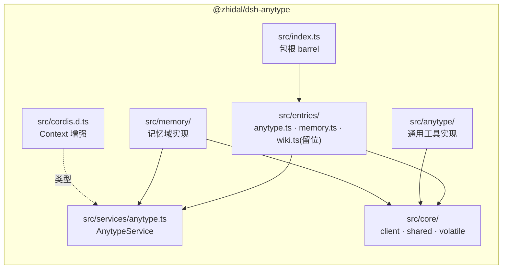

# dsh-anytype 的 bundle 架构：一个包，多个插件行

> 本文说明 `@zhidal/dsh-anytype` 这个**包**如何同时提供**多个插件行**，
> 以及它们之间如何组合（service 依赖 + 共享连接配置）。
> 想直接用记忆能力，请看 [memory/](memory/) 那一组文档。

## 1. 为什么是「一个包、多个插件行」

重构前，anytype 系列是**三个各自独立的包**：

| 包                           | 角色                              | 问题                                             |
| ---------------------------- | --------------------------------- | ------------------------------------------------ |
| `@zhidal/dsh-anytype`        | 通用 Anytype 工具（30 个）        | 作为 plain dependency 装上后**静默不加载**       |
| `@zhidal/dsh-anytype-core`   | 共享底座（client / 工具公共设施） | 纯代码包，却占一个包位                           |
| `@zhidal/dsh-anytype-memory` | 持久记忆（16 个）                 | 同上；且 apiKey/baseUrl 要在**两个插件各填一次** |

活体 e2e 暴露的真痛点有三个：

1. **plain dependency 不会自动激活**——必须去 profile 的 `cordis.patch.yml` 手写
   `- insert:` 行；写错了（平级 id 覆盖）loader 会**静默丢弃**；
2. **连接配置重复**——两个插件行各有一份 `apiKey` / `baseUrl`，改一处漏一处；
3. **包间版本耦合**——core 的任何改动都要同步三个包。

重构后：**一个包**（`@zhidal/dsh-anytype`），**两个插件行**
（`dsh-anytype` 与 `dsh-anytype-memory`），装一次即全部激活，连接配置只填一次。

## 2. 三层机制

```mermaid
flowchart TB
    subgraph 装配方["① 装配层（dsh 官方 bundle 机制）"]
        P["packages/dsh-anytype<br/>package.json: dsh.bundle.patch"]
        PF["cordis.patch.yml<br/>- insert: dsh-anytype → ./src/entries/anytype.ts<br/>- insert: dsh-anytype-memory → ./src/entries/memory.ts"]
        PROF["profile 的 cordis.patch.yml<br/>- id: dsh-anytype + config（只覆盖配置）"]
        P --> PF --> PROF
    end
    subgraph 运行层["② 运行层（cordis 插件契约）"]
        E1["entries/anytype.ts<br/>name=dsh-anytype<br/>provide=anytype"]
        E2["entries/memory.ts<br/>name=dsh-anytype-memory<br/>inject=[tools,systemPrompt,anytype]"]
    end
    subgraph 组合层["③ 组合层（具名 service）"]
        SVC["services/anytype.ts<br/>AnytypeService<br/>client + 连接配置（现读）"]
        E1 -->|ctx.provide('anytype')| SVC
        E2 -->|ctx.get('anytype')| SVC
    end
    PF --> E1
    PF --> E2
```

### 2.1 装配层：bundle

dsh 的 **bundle** 就是一个带 `dsh.bundle.patch` 的包：

```jsonc
// packages/dsh-anytype/package.json
{
  "name": "@zhidal/dsh-anytype",
  "dsh": { "bundle": { "patch": "./cordis.patch.yml" } },
}
```

`pnpm dsh plugin --profile <p> add link:<abs>/packages/dsh-anytype` 之后：

- 包名进入 profile 的 **`dsh.profile.bundles`**（而不是普通 dependencies）；
- 启动时宿主把该包的 `cordis.patch.yml` 作为**一层**叠加进插件树
  （层序：bundle 层 → profile 用户层 → home 用户层 → `--patch` 覆盖层）；
- 于是**包里的插件行自动激活**，profile 侧一行 `insert:` 都不必写。

> 实证：本仓库的 `@zhidal/dsh-llm-fallback` 就是这种 bundle——它出现在 test
> profile 的 `dsh.profile.bundles` 里，且其 patch 里的插件行自动生效。

profile 侧只需要**按 id 覆盖配置**（行由 bundle 层提供）：

```yaml
# profile 的 cordis.patch.yml
- id: dsh-anytype # 行来自 bundle 层；这里只覆盖 config
  config:
    baseUrl: http://127.0.0.1:31009
    apiKey: anytype_xxx
- id: dsh-anytype-memory
  config:
    spaceName: Agent Memory
```

⚠️ **不要在 profile 里再 `insert:` 同 id 的行**——那会让同一插件被实例化两次、
同名工具注册两次（本仓库的 e2e 用「工具数恰为 46（30+16）」守住这条）。

### 2.2 一包多入口：相对路径的 name

一个 cordis 插件 = 一个入口文件（各自导出 `name` / `apply` / `Config`）。
要让一个包提供多个插件行，patch 里的 `name` 就不能只写包名——那只能对应一个入口。

dsh 的 loader 在解析 patch 时会调用 `anchorInsertedPluginNames()`：
**若 `name` 是相对/绝对路径，就把它转成 file URL**（相对路径的基准是
**patch 文件所在目录**）。于是：

```yaml
# cordis.patch.yml（包内）
- insert:
    - id: dsh-anytype
      name: './src/entries/anytype.ts'
    - id: dsh-anytype-memory
      name: './src/entries/memory.ts'
```

转成绝对路径后与「包被装到哪儿」无关（`link:` 源码目录 / npm 包目录都行）。

> 实证：安装器会先校验包内 patch 文件的 YAML 与路径；加载阶段实例日志出现
> `[dsh-anytype] plugin loaded` 与 `[dsh-anytype-memory] plugin loaded`。
>
> 注意：patch 文件是 **YAML**，注释必须用 `#`（写成 TS 风格的 `/** */` 会被
> 安装器判为 YAML 解析失败并回滚安装）。

### 2.3 组合层：具名 service

两个插件行共享同一把钥匙，靠的是 **具名 service**（官方的组合范式，参考
`@deepseek-ai/dsh-tools` 的 `ToolRuntime extends Service`——它同样以具名方式
注册、由别的插件 `inject: ['tools']` 消费）。

```ts
// entries/anytype.ts（插件行①）
export const name = 'dsh-anytype';
export const provide = 'anytype'; // 声明本行提供的服务名
export function apply(ctx, config) {
  const { service, dispose } = provideAnytypeService(ctx, readConnection);
  ctx.effect(() => dispose); // 随插件卸载注销
  registerAnytypeTools(ctx, service.client);
}

// entries/memory.ts（插件行②）
export const name = 'dsh-anytype-memory';
export const inject = ['tools', 'systemPrompt', 'anytype']; // 等服务就绪
export function apply(ctx, config) {
  const service = ctx.get('anytype'); // inject 保证已就绪
  const store = new MemoryStore(service.client);
  registerMemoryTools(ctx, store);
}
```

**为什么不用 `class X extends Service`**：本仓库的约定是 `@deepseek-ai/cordis`
**只做类型引用**（运行时由宿主提供，插件不打包框架）。要拿到 cordis 的 `Service`
基类就得引入运行时依赖，违反该约定；而且本服务**没有需要随卸载释放的资源**
（客户端是无状态的 HTTP 调用）。故用「普通类 + `ctx.provide('anytype', …)`」
达到同样的具名服务语义：依赖方 `inject: ['anytype']` 会在服务就绪后被唤醒。

**类型可见性**：`ctx.anytype` 的类型来自 `src/cordis.d.ts` 的 module augmentation，
并由 `package.json` 的 `types` 字段指向它——否则宿主的 tsconfig 看不到包内
`.ts` 里的 inline augmentation（做法与 `@zhidal/dsh-llm-fallback` 的
`src/cordis.d.ts` 一致）。

### 2.4 配置归属

| 类别         | 字段                                                                                                                            | 归属                |
| ------------ | ------------------------------------------------------------------------------------------------------------------------------- | ------------------- |
| **连接类**   | `baseUrl` / `apiKey` / `apiVersion` / `requestTimeoutMs` / `maxResponseChars`                                                   | 插件行①（唯一一份） |
| **通用工具** | `enabled` / `disabledGroups`（10 组）                                                                                           | 插件行①             |
| **记忆语义** | `spaceName` / `spaceId` / `defaultStatus` / `recallLimit` / `recallMaxTokens` / `embeddingBatchSize` / `disabledGroups`（5 组） | 插件行②             |

设置面板里，**apiKey 只出现一次**；记忆插件行的面板没有连接字段。
该契约由 `src/index.test.ts` 的单测锁定（断言两边的 schema 字段集互不越界）。

## 3. 包内结构



| 路径                      | 内容                                                 |
| ------------------------- | ---------------------------------------------------- |
| `src/entries/anytype.ts`  | 插件行①：通用 Anytype 工具 + 提供 `anytype` 服务     |
| `src/entries/memory.ts`   | 插件行②：持久记忆（`inject: ['anytype']`）           |
| `src/entries/wiki.ts`     | **留位**：将来的 LLM Wiki 知识编译管道（本次不注册） |
| `src/services/anytype.ts` | `AnytypeService` + `provideAnytypeService()`         |
| `src/core/`               | 共享底座：HTTP 客户端、工具公共设施、volatile 支持   |
| `src/anytype/`            | 通用工具实现（10 个工具文件 + 配置文件）             |
| `src/memory/`             | 记忆域实现（schema/store/纯函数/16 个工具）          |
| `src/cordis.d.ts`         | `Context.anytype` 的类型增强                         |
| `src/index.ts`            | 包根 barrel（导出插件行①契约 + 公共 API）            |
| `cordis.patch.yml`        | bundle 层：两个插件行                                |
| `docs/memory/`            | 记忆子系统的 11 篇设计文档                           |

## 4. 如何新增一个插件行

以将来的 LLM Wiki 为例：

1. 新建 `src/wiki/`（实现）与 `src/entries/wiki.ts`（插件契约：
   `name` / `inject` / `apply` / `Config`）；
2. 复用连接：`inject: [..., 'anytype']` + `ctx.get('anytype')`——
   **不要自己再读一份 apiKey**；
3. 在 `cordis.patch.yml` 追加一行：
   ```yaml
   - id: dsh-anytype-wiki
     name: './src/entries/wiki.ts'
   ```
4. 在 `src/index.ts` 补 barrel 导出；在 `src/index.test.ts` 补「工具名唯一」
   断言（工具总数随之从 46 增长）；
5. 装包即生效——**不需要改 profile**（profile 侧最多按 id 覆盖 config）。

## 5. 迁移指引（从旧的三个包）

| 旧                                        | 新                                                     |
| ----------------------------------------- | ------------------------------------------------------ |
| `@zhidal/dsh-anytype-core`                | 包内 `src/core/`（经 `exports["./core"]` 对外暴露）    |
| `@zhidal/dsh-anytype-memory`              | 包内插件行②（`src/entries/memory.ts` + `src/memory/`） |
| `@zhidal/dsh-anytype`（plain dependency） | 同一包，升级为 **bundle**（`dsh.bundle.patch`）        |

profile 侧：

```diff
- insert:
-     - id: dsh-anytype
-       name: "@zhidal/dsh-anytype"
-       config:
-         baseUrl: ...
-         apiKey: ...
+ - id: dsh-anytype          # 行由 bundle 层提供，这里只覆盖 config
+   config:
+     baseUrl: ...
+     apiKey: ...
+ - id: dsh-anytype-memory   # 记忆行的配置（语义类）
+   config:
+     spaceName: Agent Memory
```

安装侧：把 plain dependency 换成 bundle 即可——

```bash
pnpm dsh plugin --profile test remove @zhidal/dsh-anytype
pnpm dsh plugin --profile test add link:<repo>/packages/dsh-anytype
```

## 6. 已知边界

- **设置面板不渲染 bundle 组件的配置表单**（宿主行为，2026-10-24 实测）：Plugins
  面板能列出包的每个插件行（Components 区，含独立的启用开关 ✅），但**不出
  schemastery 配置表单**。对照：同为 bundle 的 `dsh-llm-fallback` 页面上有表单，
  那是它的 `dsh.client` 客户端插件自渲染的，不是宿主渲染的 schemastery 表单。
  因此本包的配置走 **profile patch 按 id 覆盖**（§2.1），改配置 = 编辑 profile
  的 `cordis.patch.yml`。若将来需要面板编辑，照 `dsh-llm-fallback` 的模式给
  本包加 `dsh.client` 设置界面即可，装配层无需改动。
- **实体安装（npm/git/tarball）不支持**：入口是 `.ts` 源码，Node 拒绝剥离
  `node_modules` 下 realpath 的 `.ts`（`ERR_UNSUPPORTED_NODE_MODULES_TYPE_STRIPPING`），
  宿主只报静默的 `failed to import`。本包目前只支持 `link:` 安装；
  若要发布到 npm，需照 `dsh-llm-fallback` 的模式改成构建式（esbuild → dist）。
- **bundle 层的行不能被 profile 平级 id 覆盖**：要改配置必须用 `- id: <同一 id>`
  - `config`（`insert` 才会被丢弃）。
- **服务名全局唯一**：`anytype` 这个名字在插件树里是全局的，别处不要占用。
- **Anytype v2 是 pre-release**：能力面以本机 `/v2/docs/openapi.json` 自省为准。

## 7. 相关文档

- 记忆子系统：[docs/memory/](memory/)（01 架构 · 02 记忆模型 · 03 流程 · 04 工具 API ·
  05 Anytype 即索引 · 06 LLM/向量委派 · 07 方案审查 · 08 生态对照 · 09 限制 · 10 路线图）
- 包 README：`../README.md`（安装、配置、插件行清单）
