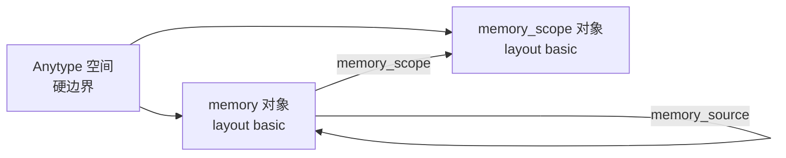
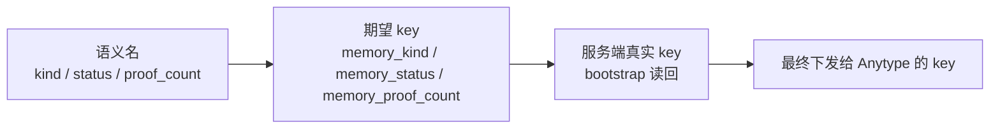
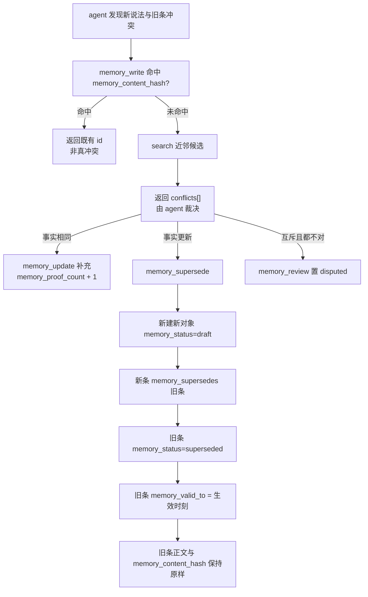

# dsh-anytype-memory 记忆模型

> **本文回答什么问题**：一条「记忆」在 Anytype 里长什么样、有哪些属性、边怎么连、什么该记什么不该记、矛盾和遗忘怎么处理、scope 到底管什么。
>
> **阅读前置**：
>
> - 已读《01 架构设计》，知道「零本地状态」「语义工作外包给 agent」这两条前提。
> - 了解 Anytype 对象模型：对象 = 类型化 `properties` + `blocks`；标题在 `properties.name`、描述在 `properties.description`；Anytype 的 link 天然双向（`links` / `backlinks` 自动生成）。
> - 工具的参数/返回契约见同目录《工具 API 参考》；本文件只定义**数据语义**。
> - **路径约定**：`packages/dsh-anytype-memory/**` 为规划态路径。

---

## 1. 模型总览

一句话：**一条记忆 = 一个 Anytype 对象**。

没有「记忆表」，没有「字段表」，没有「索引表」。`kind`、`status`、`confidence`、`scope`、关系、向量，全部是这个对象上的属性（实际属性 key 一律带 `Memory ` 前缀，见 §2.0）。agent 召回时拿到的不是「检索结果片段」，而是**可被打开、可被编辑、可被人工审阅的对象**。



### 1.1 两种类型

| 类型 key       | layout  | 角色                                      |
| -------------- | ------- | ----------------------------------------- |
| `memory`       | `basic` | 记忆本体。一条记忆一个对象                |
| `memory_scope` | `basic` | 软作用域标记。project / agent / user 三类 |

只允许这两种类型。插件**不**为 `kind` 的不同取值建不同类型——`kind` 是 `memory` 上的一个 select 属性，不是类型。理由：类型分裂会让「跨 kind 检索」退化成多次 search，也让 `supersedes` 这类跨类型边变得不自然。

> **活体实测（2026-10-23，Anytype-Version 2025-11-08）**：`memory` 类型**必须**用 `basic` 布局，
> **不能用 `note`**。`note` 布局下，快捷创建体（`{type, name, markdown}`）的 `name`
> 会被当成**正文块**而不是标题——对象 `properties.name` 为空、正文里多出一段，
> **标题能力直接丢失**。而记忆条目的「一行事实」就是它的标题，故用 `basic`
> （`todo` / `bookmark` 布局同样保留标题，但 `basic` 语义最贴）。
> `bootstrap` 对**已存在**的类型会 `PATCH` 校正布局（见《03 关键流程》①）。
>
> 对应的读取口径：**对象标题在 `properties.name`**——对象文档
> （`GET /v2/spaces/{id}/objects/{oid}`）**没有顶层 `name` 字段**。

---

## 2. 属性字典

### 2.0 命名纪律：显示名一律带 `Memory ` 前缀

Anytype 空间自带一批**内置属性**（活体实测 **41 个**：`origin(number)`、
`source(url)`、`status(select)`、`tag(multi_select)`、`links` / `backlinks(objects)`、
`assignee`、`creator`、`due_date`、`done` …）。

插件若用 `Origin` / `Source` / `Status` 这类朴素显示名铸属性，会与既有属性
**同名不同格式** → 服务端 **400 `property format conflict`**（issues 指到
`/type_properties/N/format`，提示「omit format to use the existing property as
it is, or create a new property under a different key」）。

> **活体实测（2026-10-23）**：上面的 400 就是这么来的——`origin` 内置属性是
> `number`，插件想铸 `select` 的 `Origin`，服务端直接拒。

因此插件自有属性**一律**用 `Memory ` 前缀的显示名（key 由显示名派生为
`memory_*`），既避开冲突，又在用户的空间里自成一族、清晰可辨。

**唯一例外是 `tag`**：直接**复用内置的 `tag(multi_select)`**——它本来就是
Anytype 的标签概念，复用比另造一个 `memory_tag` 更符合用户直觉（且不污染词表）。

### 2.1 `memory` 类型属性

| key                      | 显示名                 | 格式         | 取值域 / 格式                                                                                  | 语义                                                  | 默认               |
| ------------------------ | ---------------------- | ------------ | ---------------------------------------------------------------------------------------------- | ----------------------------------------------------- | ------------------ |
| `name`                   | Name（内置）           | text         | 短标题（≤200 字符）                                                                            | 记忆的一句话事实。**对象标题**。检索命中主要展示项    | 必填               |
| `memory_kind`            | Memory kind            | select       | `fact` / `decision` / `preference` / `lesson` / `procedure` / `episode` / `summary` / `entity` | 记忆类别。决定写入白名单与召回权重                    | `fact`             |
| `memory_status`          | Memory status          | select       | `draft` / `approved` / `disputed` / `superseded` / `archived`                                  | 生命周期状态                                          | `draft`            |
| `memory_origin`          | Memory origin          | select       | `agent` / `user`                                                                               | 谁写的。**`user` 条目永不被机器自动 supersede**       | `agent`            |
| `memory_source_channel`  | Memory source channel  | select       | `user` / `tool` / `web` / `agent`                                                              | 信息来源通道（投毒防御的通道标记）                    | `agent`            |
| `memory_scope`           | Memory scope           | objects      | `memory_scope` 对象 id 数组                                                                    | 归属的项目/agent/用户域                               | 由 `scope_id` 决定 |
| `memory_source`          | Memory source          | objects      | 对象 id 数组                                                                                   | 来源素材对象（会话/文件/网页等原始素材）              | 空                 |
| `memory_relates_to`      | Memory relates to      | objects      | 对象 id 数组                                                                                   | 受控边：相关                                          | 空                 |
| `memory_derived_from`    | Memory derived from    | objects      | 对象 id 数组                                                                                   | 受控边：派生自                                        | 空                 |
| `memory_contradicts`     | Memory contradicts     | objects      | 对象 id 数组                                                                                   | 受控边：与……矛盾（尚未裁决的冲突）                    | 空                 |
| `memory_supersedes`      | Memory supersedes      | objects      | 对象 id 数组                                                                                   | 受控边：取代（新版指向旧版）                          | 空                 |
| `memory_mentions`        | Memory mentions        | objects      | 对象 id 数组                                                                                   | 受控边：提及（弱关联）                                | 空                 |
| `memory_valid_from`      | Memory valid from      | date         | ISO                                                                                            | 世界真值起始时间（双时序之一）                        | 空                 |
| `memory_valid_to`        | Memory valid to        | date         | ISO                                                                                            | 世界真值结束时间；被取代时写旧条，失效不删            | 空                 |
| `memory_observed_at`     | Memory observed at     | date         | ISO                                                                                            | 观测到该事实的时间（双时序之二）                      | 写入时刻           |
| `memory_created_at`      | Memory created at      | date         | ISO                                                                                            | 写入时间                                              | 写入时刻           |
| `memory_confidence`      | Memory confidence      | number       | 1–10 整数                                                                                      | 置信度                                                | 由 agent 填        |
| `memory_importance`      | Memory importance      | number       | 1–10 整数                                                                                      | 重要度。参与 boost 与巩固排序                         | 由 agent 填        |
| `memory_salience`        | Memory salience        | number       | 0–1 小数                                                                                       | 显著度。**衰减轴**：随时间/归档下降                   | `1`                |
| `memory_proof_count`     | Memory proof count     | number       | ≥0 整数                                                                                        | 佐证计数                                              | `0`                |
| `memory_access_count`    | Memory access count    | number       | ≥0 整数                                                                                        | 被召回次数。**自测量**                                | `0`                |
| `tag`                    | Tag（**内置复用**）    | multi_select | 自由词表                                                                                       | 主题标签，供 filter 用                                | 空                 |
| `memory_content_hash`    | Memory content hash    | text         | hex                                                                                            | 归一化正文的 sha256(scope\|kind\|content)——原生幂等键 | 写入时计算         |
| `memory_idempotency_key` | Memory idempotency key | text         | 任意串                                                                                         | 写入时的防重键（与 `Idempotency-Key` 头同值）         | 写入时记录         |
| `memory_extractor`       | Memory extractor       | text         | 标识                                                                                           | 产出该记忆的模型/版本标识（provenance）               | 由 agent 填        |
| `memory_run_id`          | Memory run id          | text         | 标识                                                                                           | 产出该记忆的会话/批次标识（provenance）               | 由 agent 填        |
| `memory_embedding`       | Memory embedding       | text         | base64(Float32 小端)                                                                           | 向量。**插件只编解码，不生成**                        | 空                 |
| `memory_embedding_model` | Memory embedding model | text         | 模型标识                                                                                       | 向量所属模型标识；不同模型的向量禁止混算              | 空                 |
| `memory_embedding_dim`   | Memory embedding dim   | number       | 正整数                                                                                         | 向量维度；与查询向量维度不符即剔除该条                | 空                 |
| `memory_reviewed_by`     | Memory reviewed by     | text         | 标识                                                                                           | 审核裁决者（审计字段）                                | 空                 |
| `memory_reviewed_at`     | Memory reviewed at     | date         | ISO                                                                                            | 审核裁决时间（审计字段）                              | 空                 |

**正文不占属性位**：记忆正文以 `markdown` 随创建请求提交，落为对象的
**块（blocks）**；`basic` 布局的标题在 `properties.name`。上表里没有
`description` 行——插件不把正文塞进内置 `description` 属性。

### 2.2 `memory_scope` 类型属性

| key          | 显示名       | 格式   | 取值域                       | 语义                                          |
| ------------ | ------------ | ------ | ---------------------------- | --------------------------------------------- |
| `name`       | Name（内置） | text   | 自由                         | 作用域显示名（如 `proj-atlas`、`agent-main`） |
| `scope_kind` | Scope kind   | select | `project` / `agent` / `user` | 作用域类别                                    |
| `scope_key`  | Scope key    | text   | 稳定标识                     | 机器可读键                                    |

### 2.3 三层 key 映射：语义名 → 期望 key → 服务端真实 key

工具层**不直接用属性 key 说话**，而是用**语义名**（`kind` / `status` /
`content_hash` …）。映射由 `src/memory/tools/shared.ts` 的 `propertyKey()` 完成，
共三层：



| 层             | 谁负责                 | 规则                                                                                          |
| -------------- | ---------------------- | --------------------------------------------------------------------------------------------- |
| 语义名         | 工具层                 | `kind` / `status` / `contentHash` / `proof_count`（snake_case 与 camelCase 都认）             |
| 期望 key       | `src/memory/schema.ts` | `MEMORY_PROPERTY_KEY` / `EDGE_PROPERTY_KEY` 集中表；全部 `memory_*` 前缀（`tag` 除外）        |
| 服务端真实 key | `src/memory/store.ts`  | bootstrap 后读回 `GET /v2/spaces/{id}/properties`，按**显示名**匹配得到；匹配不到退回期望 key |

**为什么需要第三层**：Anytype 的 `POST /types` 用 `property_definitions` 铸属性时，
**key 由显示名派生**，规范未承诺派生规则；而 `POST /properties` 允许显式传 `key`。
故策略是「建类型时用显示名铸 → 建成后读回真实 key → 之后一律用真实 key」。
key 漂移时 bootstrap 会在 `warnings[]` 里报 `property key drift`。

### 2.4 属性值形状与词表纪律

| 规则                               | 说明                                                                                             |
| ---------------------------------- | ------------------------------------------------------------------------------------------------ |
| **列表型键取数组**                 | `select` / `multi_select` / `objects` / `files` 的值是**数组**（选项名或对象 id）                |
| **标量型键取标量**                 | `text` / `number` / `date` / `checkbox` 的值是标量                                               |
| `set_properties` 的 `set` 同此语义 | `add` / `remove` **仅对列表型键有效**                                                            |
| **未知属性键 → 400**               | 服务端会列出已知键并给「did you mean」提示——拼错的键立刻暴露，不会被静默铸造                     |
| **未知 select 选项名 → 400**       | 除非请求带 `create_missing_options=true`                                                         |
| **受控词表不开该参数**             | `memory_kind` / `memory_status` / `memory_origin` / `memory_source_channel` **不开**——拼错即报错 |
| **开放词表才开**                   | `tag`（复用内置 multi_select）**开**——允许新标签自动建选项                                       |

---

## 3. 边的语义

所有边都是 `objects → memory` 的 relation，Anytype 原生双向：`links` 看到出边，`backlinks` 看到入边。

| 边（语义名）   | 属性 key              | 方向语义          | 写入方                 | 用途                                                            |
| -------------- | --------------------- | ----------------- | ---------------------- | --------------------------------------------------------------- |
| `source`       | `memory_source`       | 本条 → 原始素材   | 写路径                 | 溯源：会话/文件/网页等原始素材对象                              |
| `derived_from` | `memory_derived_from` | 本条 → 母本条     | 写路径                 | 加工关系（摘要从摘要来）                                        |
| `relates_to`   | `memory_relates_to`   | 本条 ↔ 主题相关条 | 写路径 / `memory_link` | 弱关联，做召回的关系臂                                          |
| `contradicts`  | `memory_contradicts`  | 本条 → 冲突条     | agent 裁决后           | 标记冲突但**不自动改**对方                                      |
| `supersedes`   | `memory_supersedes`   | 新条 → 旧条       | `memory_supersede`     | 取代链；配套旧条 `memory_status=superseded` + `memory_valid_to` |
| `mentions`     | `memory_mentions`     | 本条 → 被提及对象 | agent                  | 实体型记忆指向其它记忆                                          |

**受控边白名单**：`memory_link` 只接受 5 个受控边（`relates_to` /
`derived_from` / `contradicts` / `supersedes` / `mentions`）；`source` 由
`memory_write` 的 `source_object_id` 写入，不走本工具。其它 relation 名一律拒绝，
防止 agent 随手造出无语义边。

> **relation 无目标类型**：v2 的 `create_type` / `create_property` 都没有
> 「relation 指向哪个类型」的字段——`objects` 格式属性可存任意对象 id，
> 无法在 schema 层限定目标类型。故「边只指向 memory 对象」这条不变量由
> **插件层校验**（`memory_link` 写入前读目标对象的 type 并拒绝非 `memory`），
> 不依赖 Anytype 的类型系统兜底。

### 3.1 边与状态机是配套的

`supersedes` 边**必须**与旧条的 `status=superseded` + `valid_to` 同时写入。少一边就是历史断裂——只写边不改状态，会让旧条在召回里继续以「有效」身份出现；只改状态不写边，则无法从新条回溯到被取代的对象。

> **活体实测（2026-10-23）**：**同一个 etag 只能写一次**——连续两次 `PATCH`
> （即便都带同一个 `If-Match` etag）第二次必得 **409 `etag_mismatch`**。
> 故 `memory_supersede` 把 `memory_valid_to` 与 `memory_status=superseded`
> **合并进同一个 `set_properties` op**（一次原子写），绝不拆成两次 PATCH。

---

## 4. 语义规则

### 4.1 谁写、写到哪个状态

| 写入方                     | `memory_origin` | `memory_status`                             | 规则                                                                                            |
| -------------------------- | --------------- | ------------------------------------------- | ----------------------------------------------------------------------------------------------- |
| agent 写（`memory_write`） | `agent`         | 取配置 `defaultStatus`（默认 `draft`）      | AI 写入默认 `draft`，进召回但**不自动被当真**                                                   |
| 人工在 Anytype 里直接写    | `user`          | 用户说了算                                  | **插件写入路径不产生 `origin=user`**——人写条目只能来自人工编辑或 `memory_review` 之后的人工调整 |
| 人工在 Anytype 里改        | —               | 用户说了算                                  | 人工编辑优先于机器判断                                                                          |
| `memory_review`            | 不改            | 迁移到 `approved` / `disputed` / `archived` | 评审闸门；同时写 `memory_reviewed_by` / `memory_reviewed_at`                                    |

> **实现口径**：`memory_write` 恒定写 `memory_origin=agent`；「用户口述」目前
> **只能由 agent 转录后写入**，仍落 `origin=agent`。若要让某条成为
> `origin=user` 的信任锚点，需人工在 Anytype 里改写该属性——插件不提供
> 「把某条标为 user 写的」工具（这正是「人机之分」这条防线不被 agent 自己
> 绕开的方式）。
>
> `memory_review` 的 `reject` 语义是「转 `archived`」而非删除；它**不**把状态
> 退回 `draft`（退回待定走 `memory_update` 显式 `set_properties`）。

### 4.2 写入白名单

**该记**（`kind` × 判据）：

| `kind`       | 收录判据                                                      |
| ------------ | ------------------------------------------------------------- |
| `preference` | 稳定的偏好/风格/约定（"用中文回复"、"提交前先跑 lint"）       |
| `decision`   | 决策**及其理由**（只记结论不记 why 的决策不合格）             |
| `fact`       | 持久事实（部署端口、依赖版本、接口契约）                      |
| `lesson`     | 硬教训（踩过的坑及其根因）                                    |
| `procedure`  | 可复用流程步骤                                                |
| `entity`     | 稳定的实体档案（人、服务、仓库）                              |
| `summary`    | 对一组记忆的压缩总结（必须挂 `derived_from`）                 |
| `episode`    | 一次性事件（低价值，默认 `importance` 低、`salience` 衰减快） |

**不该记**：

- 寒暄、致谢、确认收到。
- 对已有记忆的复述（去重后直接返回既有 id，不新建）。
- 低置信度猜测（`confidence` 低于阈值，且 `kind=fact` 时尤其）。
- 瞬时状态（"当前分支是 main" 这类几分钟内就失效的信息）。
- 一次性任务的中间产物。

这些判据由 systemPrompt 指引 section 写给 agent，插件本身**不拦截**——它只在 `memory_write` 时校验 `kind` 是否在配置白名单内。

### 4.3 矛盾处理：永不覆盖，永不删除



硬规则：

| 规则                                               | 说明                                                                                |
| -------------------------------------------------- | ----------------------------------------------------------------------------------- |
| 旧条正文**不可变**                                 | supersede 不改旧条的正文块与 `memory_content_hash`                                  |
| 旧条**不删除**                                     | 只改 `memory_status` 与 `memory_valid_to`                                           |
| `memory_origin=user` 的条**不自动 supersede**      | 机器不得改写人类确立的事实；`memory_supersede` 对此类旧条**拒绝执行**并要求人工确认 |
| 新条默认 `memory_status=draft`                     | 取代关系成立 ≠ 内容已批准；`memory_review` 才能升 `approved`                        |
| `memory_contradicts` 与 `memory_supersedes` 不同义 | 「矛盾」表示并存冲突待议（「取代」表示已裁定新旧）                                  |

### 4.4 遗忘：衰减 + 归档

遗忘是三段式，**没有删除路径**：

1. **衰减**：`memory_salience` 随时间下降（衰减轴）；`memory_access_count` 高、`memory_importance` 高的条目衰减更慢。
2. **归档**：`memory_status=archived`。归档条目**不进默认召回结果**，但仍可被 `memory_search` / `memory_get` / `memory_list` 检索到。
3. **保留**：对象本体永久留在空间里，除非用户在 Anytype 里手动删除。

`memory_access_count` 是**自测量**机制：召回命中时可 +1（`memory_recall` 的 `bump_access_count=true`，每次调用**封顶 5 条**以避开限速）。被反复用到的记忆会积累更高的显著性，形成「越常用越容易召回」的正反馈；反之长期不被召回的条目自然沉底。

> **为什么不能物理删除**（活体实测 2026-10-23）：`DELETE /v2/spaces/{id}/objects/{oid}`
> **只对本 API key 创建的对象有效**，对应用内/他人创建的对象一律
> **403 `not_created_by_this_key`**（`dry_run=true` 也不豁免）；而 HTTP v2
> **根本没有删除 space 的端点**。故记忆条目一律走 `status=archived`，
> 测试空间只能人工在 Anytype 里删。

### 4.5 巩固（rollup）：插件只出计划

插件**不做**自动合并。`memory_candidates` / `memory_suggest_links` 只产出：

- 相似簇（按 `content_hash` 前缀 / 标签重合度 / 向量近邻聚成的候选组）
- 每个簇的「建议合并对象」（哪几条该并成一条、并到哪条）
- 建议新增的关系边（`relates_to` / `derived_from`）

真正的合并由 agent 用自己的 LLM 写合并稿，再调用 `memory_update` / `memory_supersede` 回写。理由见《01 架构设计》C4：插件不得替 agent 决定内容。

---

## 5. 作用域语义

### 5.1 三层边界

| 边界         | 载体                                      | 强度             | 说明                                                                             |
| ------------ | ----------------------------------------- | ---------------- | -------------------------------------------------------------------------------- |
| **空间**     | Anytype space                             | **硬边界**       | 由 API key 的授权范围决定。插件只能读写被授权的空间，越权由服务端拒绝（401/403） |
| **类型**     | `memory` / `memory_scope`                 | 硬边界（插件内） | 记忆只在 `memory` 类型里，不会与用户其他对象混在一起                             |
| **软作用域** | `memory_scope` 对象（project/agent/user） | 软边界           | 插件内的**过滤维度**，用于分组、召回收窄与统计                                   |

### 5.2 `memory_scope` 三类

| `scope_kind` | 语义                    | 典型 `scope_key`               |
| ------------ | ----------------------- | ------------------------------ |
| `project`    | 某个项目的记忆域        | `proj-atlas`                   |
| `agent`      | 某个 agent 角色的记忆域 | `agent-main`、`agent-reviewer` |
| `user`       | 跨项目的用户个人偏好域  | `user-global`                  |

一条记忆**可以**同时属于多个 scope（`memory_scope` 是 objects 属性，可多选），但实际约定是「一条记忆主属一个 scope」，需要跨域共享时用 `memory_relates_to` 表达。

### 5.3 关键澄清：collection 不是文件夹

> Anytype 的 **collection 是「属性分组视图」，不是目录/文件夹**。

它的语义是「按某些属性的取值把对象聚成若干组」，对象可以同时出现在多个 collection 里。它**不是**命名空间，**不能**承担 scope 职责。

因此：

- scope 一律用 `memory_scope` **对象**表达（`scope` 属性指向它）；
- collection **只作为视图**使用（例如给用户看「按 kind 分组的记忆板」「按 scope 分组的记忆板」）；
- 插件**不会**用 collection 做记忆隔离，也不会把「记忆是否属于某域」依赖于 collection 成员关系；
- 任何「把记忆放进某文件夹」的表述在本插件里都应翻译成「把记忆的 `scope` 属性指向某个 `memory_scope` 对象」。

### 5.4 跨作用域召回

默认召回**不**按 scope 收窄——agent 的记忆是全局的，scope 只作为召回结果的标注维度。配置项 `defaultScopeKey` 决定**新写入**记忆默认挂哪个 scope，不影响读。

---

## 6. 归一化与 `content_hash`

### 6.1 归一化规则

`content_hash` 是查重的主键，必须对「语义等价的表述」稳定、对「实质差异」敏感。归一化流水线（`src/memory/dedup.ts`，纯函数）：

| 步  | 动作                          | 目的                                             |
| --- | ----------------------------- | ------------------------------------------------ |
| 1   | Unicode NFC 归一化            | 合并「组合形式 vs 预组合形式」的等价写法（如 é） |
| 2   | 去除首尾空白                  | 消除排版差异                                     |
| 3   | 空白折叠（连续空白 → 单空格） | 消除换行/缩进差异                                |
| 4   | 哈希                          | SHA-256 → hex                                    |

**注意**：**不做**小写化、**不做**标点剥离。中文无大小写问题；英文大小写与
标点往往携带信息（`JSON` vs `json`、有无句号），一律折叠会引入误判。
归一化因此只针对**排版差异**，`content_hash` 用于**精确重复**检测，**不是**
语义相似度——语义近似由向量臂与 `memory_candidates` 承担。

> **口径已统一**（2026-10-23）：本节与 [05](./05-anytype-as-source.md) §6、
> 与实现 `src/memory/dedup.ts` 三方一致。

### 6.2 哈希的边界

- 哈希的是 `scope_id | kind | normalize(content)`。`kind` 参与是因为「同正文、
  不同类别」在语义上不是同一条记忆（例如一句「重启服务」是 `procedure` 还是
  `lesson`）；`scope_id` 参与是因为**不同作用域的同内容不算重复**（项目 A 与
  项目 B 各有一条「用 pnpm 管理依赖」是两条独立记忆）。
- **不**哈希 `tag`、`memory_confidence` —— 这些是可变属性，变了不代表内容变了。
- 哈希变化意味着「正文被改过」。因此 `memory_update` **禁止**改 `memory_content_hash`
  （除非同时改正文），否则查重链路会失真。

### 6.3 幂等

| 场景                   | 处理                                                            |
| ---------------------- | --------------------------------------------------------------- |
| 同一条内容重复写入     | `memory_content_hash` filter 命中 → 直接返回既有 id，**不新建** |
| 网络超时后重试         | 复用同一 `Idempotency-Key` → 服务端重放已存响应（不重复创建）   |
| 同 key 换了正文        | 服务端返 409 `idempotency_conflict` → 换新 key                  |
| 归一化后不同但语义相同 | 查重不命中 → 落到近邻检索 → 以 `conflicts[]` 交 agent 裁决      |

---

## 7. 向量存储

| 项       | 规定                                                                                                                                                           |
| -------- | -------------------------------------------------------------------------------------------------------------------------------------------------------------- |
| 编码     | `Float32Array` → 小端字节 → `base64` → 存入 `memory_embedding` 文本属性                                                                                        |
| 解码     | `base64` → 字节 → 按小端读 `Float32` → 长度必须等于 `memory_embedding_dim`                                                                                     |
| 模型标识 | 存 `memory_embedding_model`（模型名 + 版本，如 `bge-m3-v1.5`）                                                                                                 |
| 维度     | 存 `memory_embedding_dim`                                                                                                                                      |
| 校验     | 读回时：`memory_embedding_dim` 与解码长度必须一致；`memory_embedding_model` 与当前期望模型不符的条目**直接剔除**（不参与向量臂排序），并在召回结果里报告剔除数 |
| 归一化   | 写入前建议 agent 送 L2 归一化向量；插件做余弦时也接受未归一化向量（余弦自带模长除法）                                                                          |
| 计算位置 | **agent 计算，插件只编解码**。插件提供 `memory_set_embedding` 接收 base64 并做校验落盘                                                                         |

为什么把向量存成属性而不是让 Anytype 做向量检索：Anytype v2 当前**没有**向量索引端点，且插件零本地状态——不能建本地向量库。插件采取「Anytype 检索候选 → 取回向量 → 本地算余弦」的折中：向量在**传输与存储**上完全在 Anytype 侧，只有**打分**发生在插件内存里（瞬时，无持久化）。

---

## 8. 分块策略

`src/memory/chunk.ts` 是**确定性**的零 LLM 分块：同样输入永远得到同样切分。

| 规则         | 说明                                                         |
| ------------ | ------------------------------------------------------------ |
| 切分点优先级 | 空行 → 段落标记 → 中文句号/问号/叹号 → 英文句点 → 硬长度上限 |
| 目标块长     | 约 400 字符（可配置），硬上限 800 字符                       |
| 重叠         | 相邻块保留约 10% 重叠，避免跨块语义断裂                      |
| 最小块       | 低于 50 字符的块与后一块合并                                 |
| 输出         | 纯字符串数组，不含元数据（块序号由调用方按顺序附加）         |

分块只服务一个场景：长正文（`episode` / `summary`）在向量化前需要切成多个向量。**记忆本体仍是一个对象**——块是向量的粒度，不是存储的粒度。

---

## 9. 召回评分

`src/memory/recall.ts`（纯函数）分三步：融合 → 加权 → 过滤与截断。

### 9.1 三臂候选

| 臂     | 手段                                                                                                                                                     | 产出               |
| ------ | -------------------------------------------------------------------------------------------------------------------------------------------------------- | ------------------ |
| 词法臂 | `POST /v2/spaces/{id}/search`，带 `query` + `filter`（`memory_kind` / `memory_status` 收窄）+ `sorts`（`memory_created_at` 降序）+ `fields` 投影         | 按相关度排序的候选 |
| 向量臂 | 一次 `search` 取 top-M → `fields` 投影 `memory_embedding` / `memory_embedding_model` / `memory_embedding_dim` → base64 解码 → 余弦 → 剔除模型/维度不符者 | 按余弦排序的候选   |
| 关系臂 | 首选按受控边属性过滤（`memory_relates_to IN (...)` 等）；**兜底**投影 Anytype 原生 `links` / `backlinks` 取邻居 id                                       | 关系邻域候选       |

> **关系臂的兜底（活体实测 2026-10-23）**：用**真实存在**的对象 id 做
> `memory_relates_to IN ("<id>")` 过滤 → **请求 200 但 `total=0`**（服务端接受
> 该 filter，却匹配不到任何行）。故关系臂的兜底不是「再加一个 filter」，而是
> **投影 Anytype 原生的 `links` / `backlinks`**（双向关系自动生成），把邻居 id
> 作为 `related_ids` 返回给 agent（当前 `memory_recall` 返回体已含
> `related_ids`）。`memory_doctor` 的能力探测会把这一事实报成
> `capabilities.relation_filter_rows = 0` 并附告警。

### 9.2 RRF 融合

Reciprocal Rank Fusion，`k = 60`（默认值，可配）：

```
score_rrf(d) = Σ_arms 1 / (k + rank_arm(d))
```

- 某臂没命中 → 该臂不贡献分数（不当作 0 排名）。
- 同一文档被多臂命中 → 分数相加，这是「词法+向量都认可」的自然放大。
- 融合**在 boost 之前**：先按排名融合，再用属性加权。

### 9.3 乘性 boost

```
score_final(d) = score_rrf(d) × w_recency^recency(d) × w_conf^confidence(d) × w_proof^proof(d)
```

| 因子         | 计算                                                   | 说明                             |
| ------------ | ------------------------------------------------------ | -------------------------------- |
| `recency`    | `clamp(1 - age_days / 365, 0.1, 1)`，基于 `created_at` | 时间新近性（线性衰减，下限 0.1） |
| `confidence` | `0.1 + (clamp(confidence,1,10) / 10) × 0.9`            | 置信度归一到 [0.1,1]，缺失取 0.5 |
| `proof`      | `min(1, 0.5 + proof_count × 0.1667)`，≥3 次佐证即封顶  | 证据越多越可信，缺失取 0.5       |

指数权重固定为 `recency^0.2 × confidence^0.2 × proof^0.1`（Hindsight 口径）。
boost 是**乘性**的：高置信度但极旧的条目会被 recency 因子压低，但不会被
**抬到**高相关候选之前——加性加权会犯这个错。

> **口径已统一**（2026-10-23）：本节与 [05](./05-anytype-as-source.md) §5、
> 与实现 `src/memory/recall.ts`（`finalScore` / `recencyBoost` / `scaleBoost` /
> `proofBoost`）三方一致。

### 9.4 状态过滤与预算

| 阶段     | 规则                                                                                                                                               |
| -------- | -------------------------------------------------------------------------------------------------------------------------------------------------- |
| 状态过滤 | 默认排除 `archived` 与 `superseded`；`draft` **保留**（AI 写的记忆要能被召回，但可以要求 agent 审慎引用）；`disputed` 保留但在结果里标记「有争议」 |
| 排序     | 按 `score_final` 降序                                                                                                                              |
| 预算     | 累计 token 估算超 `recallTokenBudget` 即截断；返回里带 `truncated` 与 `omitted_count`                                                              |
| 自测量   | 命中条目 `access_count` +1（写回 Anytype，失败不阻断召回）                                                                                         |

---

## 10. 不变量清单

实现期每条都应有对应断言或测试。

| #   | 不变量                                                                                                                    |
| --- | ------------------------------------------------------------------------------------------------------------------------- |
| I1  | 插件不持有任何跨调用的可变状态（零本地状态）                                                                              |
| I2  | 任何写入都不删除 Anytype 对象；删除只出现在 `memory_doctor` 清理自身探针时                                                |
| I3  | 旧条正文与 `memory_content_hash` 在 supersede 流程中保持不变                                                              |
| I4  | `memory_origin=user` 的对象永不进入自动 supersede 路径                                                                    |
| I5  | `memory_status` 的每一次迁移都落在允许的迁移表内                                                                          |
| I6  | `memory_supersedes` 边与旧条 `memory_status=superseded` + `memory_valid_to` 原子地一起生效（**同一个 PATCH、同一个 op**） |
| I7  | `memory_embedding` 解码长度必须等于 `memory_embedding_dim`，否则条目被剔除而非报错整批失败                                |
| I8  | 向量臂只接受 `memory_embedding_model` 与期望模型一致的条目                                                                |
| I9  | `memory_scope` 一律指向 `memory_scope` 对象；**从不**用 collection 表达作用域                                             |
| I10 | `filter` 与 `filters` 互斥，工具层提前拦截并给出「二选一」提示                                                            |
| I11 | 所有写请求带 `Idempotency-Key`；所有基于读-改写的操作带 `If-Match`                                                        |
| I12 | `memory_setup` 重复执行**零新建**（只补缺失属性，不覆盖用户已有调整）                                                     |
| I13 | 召回结果不包含 `archived` / `superseded` 条目（除非显式请求）                                                             |
| I14 | 召回返回体必带 `truncated` / `omitted_count` / `arms_used` / `related_ids` 等可解释字段                                   |
| I15 | 插件自有属性的显示名一律带 `Memory ` 前缀（唯一例外：复用内置 `tag`）——否则撞 `property format conflict`                  |
| I16 | 插件属性必须 `add_property` 进类型字段表——否则「会被存储并随对象返回，但按类型过滤/查询时该键被拒绝」                     |
| I17 | 记忆类型布局恒为 `basic`——`note` 布局会把对象标题吞成正文块                                                               |
| I18 | 同一个 etag 只写一次——多字段变更必须合并进同一个 `set_properties` op                                                      |

---

## 11. 待验证项

| 待验证项                                                                           | 状态 / 验证方式                                                                                                                                                                       |
| ---------------------------------------------------------------------------------- | ------------------------------------------------------------------------------------------------------------------------------------------------------------------------------------- |
| `memory` 类型的 `layout=basic` 能同时承载 `properties` 与 `blocks` 正文            | ✅ **已实测**（2026-10-23）：`basic` 保留标题与正文；`note` 会把标题吞成正文块，故不用 `note`                                                                                         |
| `objects` 属性（`memory_scope` / `memory_source` / 各边）参与 filter 与投影        | **[待活体验证]**：建一条带 `memory_scope` 指向的对象，`filter='memory_scope = "<id>"'` 断言命中                                                                                       |
| `links` / `backlinks` 投影返回对象 id 数组                                         | ✅ **已实测**：投影返回对象 id 数组；关系臂兜底依赖它                                                                                                                                 |
| `memory_content_hash` 等值过滤在 `memory` 类型上生效                               | ✅ **已实测**：命中 1（依赖该键已进字段表，见 I16）                                                                                                                                   |
| `memory_embedding` 文本属性的长度上限是否容得下 base64 向量                        | **[待活体验证]**：写一条 1024 维 Float32（base64 约 5.4KB）并读回，断言未被截断                                                                                                       |
| `tag`（内置 multi_select）的取值写入与 filter 语法                                 | **[待活体验证]**：写两个 tag 并用 `tag IN ("a","b")` 过滤，断言命中                                                                                                                   |
| `memory_valid_from` / `memory_valid_to` 与 `today()` / `daysAgo(7)` 预设的组合过滤 | **[待活体验证]**：用 `memory_valid_to IS EMPTY` 与 `memory_observed_at > daysAgo(7)` 过滤，断言结果符合预期                                                                           |
| `memory_embedding` 写入 4096 维（`MAX_VECTOR_DIM` 上限）是否被服务端接受           | **[待活体验证]**：用 `memory_set_embedding` 写 4096 维向量，观察截断 / 报错 / 接受                                                                                                    |
| 中文全文检索的**召回质量**（常用词 vs 生僻词）                                     | 部分已实测：常用词可命中（标题与正文都索引）；**生僻词/未登录词不可靠**（对象已进索引却搜不到）。量化分布 **[待活体验证]**：在同一空间分别写入常用词与生僻词各 N 条，对比命中率与排序 |
